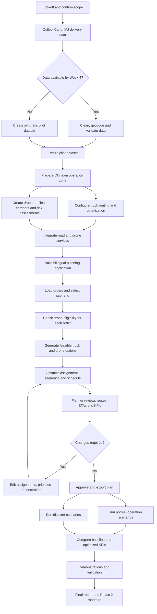

# NextBillion.ai chat transcripts — user requirements, feedback, decisions

Source: 10 exported chat files (Route Optimization Solution Architect agent sessions plus a general assistant session). All 10 parsed; the AGENTS.md preamble was skipped. Several files are duplicates or sequels of the same topic and are merged below. The user is a NextBillion solutions/support person working on customer problems. Where the assistant verified only against the schema and not a live API, that is stated.


Structure: for each conversation, first the analyst summary, then the near-verbatim transcript. All user messages are verbatim. Assistant messages are verbatim except short progress-narration lines ("I’ll inspect..."), which are dropped, and the AGENTS.md preamble and the repeated "take a complete backup of this chat" housekeeping turns, which are dropped.

---

## 5. Re-optimization resequencing test (`chat-backup (1).json`)
- **Requirement:** First-round testing with smaller partners went fine, but re-optimization behaved badly. With slots 09:00 to 11:00 (three jobs 09:00-10:00 and three 10:00-11:00), moving one early job to the later slot made the engine keep the existing sequence and shift everything forward, so all six jobs ended up 10:00 to 11:00. The partner expected a full re-sequence. The user asked for an example payload to test.
- **Delivered:** An initial `/optimization/v2` payload (one vehicle, six jobs, strict windows, `max_visit_lateness: 0`, no `sequence_order` or `relations`) and a `/optimization/re_optimization` payload using `existing_request_id` plus `job_changes.modify` for `job-early-01` with the later window.
- **Key expectation set:** The dedicated re-optimization endpoint is designed to **preserve the existing plan with minimal disruption**, not to guarantee a fresh global optimization. For true full recalculation, submit a new `/optimization/v2` request with the modified job and compare (A/B). Checks if the result looks wrong: `late_by`, any nonzero `max_visit_lateness`, and whether `sequence_order`, `relations` or a previous `solution` is fixing the order.

### Transcript — `chat-backup (1).json`

**USER:**
We’ve finished the first round of testing with our smaller partners. Overall, the route planning is working as expected, but we’re not ready to go live with the other partners yet because we still need to make a few improvements.

During testing, we identified an issue with the re-optimization request.

For example, if we have a two-hour time slot from 09:00 to 11:00, with three jobs planned between 09:00 and 10:00 and another three between 10:00 and 11:00, one of the earlier jobs may need to be rescheduled to the second time slot.

When we trigger re-optimization, it seems to preserve the existing sequence and shift the remaining orders forward. This means that all six orders may end up being scheduled between 10:00 and 11:00, creating significant delays.

Our expectation is that re-optimization would recalculate the entire sequence and distribute the orders more efficiently across the available time windows.

Can you create an example payload for the above scenario? I want to test it and see how the results come up.

**ASSISTANT:**
## Feasibility verdict

This is testable with one initial optimization followed by one re-optimization request.

One important expectation to set: NextBillion.ai’s dedicated re-optimization endpoint is designed to preserve as much of the existing plan as possible while incorporating changes. It is not guaranteed to behave like a completely fresh global optimization. The official tutorial describes it as retaining the existing route structure with minimal disruption. [NextBillion.ai re-optimization guide](https://docs.nextbillion.ai/optimization/route-optimization-api/tutorials/re-optimizing-a-route-plan)

The payload below uses strict time windows and deliberately avoids `sequence_order`, `relations`, and soft lateness. This should force the optimizer to move the remaining early jobs ahead of the rescheduled job rather than simply delaying them.

## 1. Initial optimization payload

Endpoint:

```text
POST https://api.nextbillion.io/optimization/v2?key={{API_KEY}}
```

The example uses 21 September 2026 in Asia/Kolkata:

- 09:00 = `1789961400`
- 10:00 = `1789965000`
- 11:00 = `1789968600`

```json
{
  "description": "Re-optimization resequencing test - initial plan",
  "locations": {
    "id": 1001,
    "location": [
      "12.971600,77.594600",
      "12.974100,77.591800",
      "12.976700,77.594100",
      "12.974900,77.598000",
      "12.969600,77.598500",
      "12.967100,77.595500",
      "12.968900,77.591600"
    ]
  },
  "vehicles": [
    {
      "id": "vehicle-01",
      "start_index": 0,
      "end_index": 0,
      "time_window": [
        1789961400,
        1789968600
      ],
      "max_tasks": 6
    }
  ],
  "jobs": [
    {
      "id": "job-early-01",
      "description": "Originally planned between 09:00 and 10:00; will be rescheduled",
      "location_index": 1,
      "service": 480,
      "time_windows": [[1789961400, 1789965000]]
    },
    {
      "id": "job-early-02",
      "description": "Must remain between 09:00 and 10:00",
      "location_index": 2,
      "service": 480,
      "time_windows": [[1789961400, 1789965000]]
    },
    {
      "id": "job-early-03",
      "description": "Must remain between 09:00 and 10:00",
      "location_index": 3,
      "service": 480,
      "time_windows": [[1789961400, 1789965000]]
    },
    {
      "id": "job-late-01",
      "description": "Planned between 10:00 and 11:00",
      "location_index": 4,
      "service": 480,
      "time_windows": [[1789965000, 1789968600]]
    },
    {
      "id": "job-late-02",
      "description": "Planned between 10:00 and 11:00",
      "location_index": 5,
      "service": 480,
      "time_windows": [[1789965000, 1789968600]]
    },
    {
      "id": "job-late-03",
      "description": "Planned between 10:00 and 11:00",
      "location_index": 6,
      "service": 480,
      "time_windows": [[1789965000, 1789968600]]
    }
  ],
  "options": {
    "objective": {
      "travel_cost": "duration"
    },
    "constraint": {
      "max_visit_lateness": 0,
      "max_vehicle_overtime": 0
    }
  }
}
```

Retrieve and record the resulting request `id`. Confirm that the initial solution schedules:

- `job-early-01`, `job-early-02`, and `job-early-03` before 10:00.
- The other three jobs at or after 10:00.

## 2. Re-optimization payload

This moves `job-early-01` from the 09:00–10:00 window to the 10:00–11:00 window.

Endpoint:

```text
POST https://api.nextbillion.io/optimization/re_optimization?key={{API_KEY}}
```

```json
{
  "existing_request_id": "{{INITIAL_OPTIMIZATION_REQUEST_ID}}",
  "job_changes": {
    "modify": [
      {
        "id": "job-early-01",
        "description": "Rescheduled from the first hour to the second hour",
        "location_index": 1,
        "service": 480,
        "time_windows": [[1789965000, 1789968600]]
      }
    ]
  }
}
```

According to the supplied API specification, jobs not included in `job_changes` are reused without alteration but are still re-planned. However, because re-optimization also favors plan stability, the result can remain close to the original route where constraints permit it.

## Expected result

The valid distribution after re-optimization is:

| Period | Jobs |
|---|---|
| 09:00–10:00 | `job-early-02`, `job-early-03` |
| 10:00–11:00 | `job-early-01`, `job-late-01`, `job-late-02`, `job-late-03` |

The precise order within each group may vary based on calculated travel duration.

All six jobs should not start between 10:00 and 11:00 because `job-early-02` and `job-early-03` have hard windows ending at 10:00. If they appear after 10:00, inspect:

- `late_by` on the affected route steps.
- Whether the original request actually contained a nonzero `max_visit_lateness`.
- Whether job-level `max_visit_lateness` was configured.
- Whether the returned timestamps represent arrival, start, or completion time.
- Whether `sequence_order`, `relations`, or a previously supplied `solution` is fixing the route order.

## Concise approach document

This test creates six jobs assigned to one vehicle over a two-hour shift. Three jobs initially have a 09:00–10:00 service window and three have a 10:00–11:00 window. During re-optimization, one early job is moved into the later window.

Strict time windows are used so the rescheduled job cannot cause the remaining early jobs to be pushed beyond 10:00. No explicit sequencing constraint is included, allowing the optimizer to rearrange the route.

For an A/B comparison, also submit the complete initial payload as a new `/optimization/v2` request after changing `job-early-01` to the later window. That fresh request represents full global recalculation. Compare its sequence, arrival times, lateness, duration, and unassigned jobs against the dedicated re-optimization result. If only the fresh request produces the desired sequence, the observed behavior is consistent with re-optimization’s plan-stability objective rather than a payload error.


---

## 8. Snap-to-Road / Directions-only waypoint preprocessing (`chat-backup-2026-10-21 (1).json`)
- **Requirement:** A field-technician tracking customer wanted to compute travelled distance. The user first proposed Snap-to-Road plus Directions. The customer objected to multiple Directions calls and wanted Directions only. The user proposed first point as origin, last as destination, and all others as waypoints in **one Directions call**.
- **Customer concern:** Points clustered close together (one shop opposite another) make Directions add extra kilometres through U-turns. The user proposed a buffer (about 1 km) that merges close points, or a distance-between-points filter.
- **Evaluation on 18/22/26 Aug data:** Sequential buffer clustering was better. A 2 km threshold was too aggressive (18 Aug: 12 points down to 3). For 26 Aug, 16 records became 6 routing points (origin, four waypoints, destination).
- **User decisions and feedback:** "Just do a 250 m buffer; no need for 1 km and 2 km or distance computation." Also: "Have you written Python scripts?" (the first package was Node, so a Python version was made), and "how are you deriving origin, destination and waypoints? I could find the exact matching coordinates" so the customer can check them. The final logic: sort chronologically; complete-link 250 m clusters; earliest record is the origin and latest is the destination; for each middle cluster pick an original recorded coordinate (prefer Location Punched, otherwise the medoid); never average or move coordinates. Origin and destination share a coordinate when the technician returns to the first location.
- **Tool facts used:** Directions processes waypoints in the order supplied; POST supports up to 200 waypoints; the script reads `NB_API_KEY` from the environment. Live Directions testing was not done (no key).
- **Also reported:** An app test where the key was configured but the page said an API key is required to create a map (a separate map key, entered in the browser, was needed).
- **Open item for the customer:** Can two distinct shops within 250 m share one waypoint, or should a shop identifier prevent merging?

### Transcript — `chat-backup-2026-10-21 (1).json`

**USER:**
are you running the snap to road API?
Display the snap to road result in the map as well.
And Directions API is not working for 22 and 26 Aug data

**USER:**
Give me the corrected zip file.

**USER:**
i get this error. I have configured my api key in Readme. what is the issue

**USER:**
Snap Total demo running at http://localhost:4173
NextBillion.ai API key configured.

I set my API key and I get the above response from my terminal. But yet when I load the app in the localhost, it says API key is required. I don't understand what the problem is. It especially says, an API key is required to create a map.

**USER:**
Okay, what should I do now? I did not change anything in index.html.

**USER:**
can you explain in detail the workflow followed with the example of 26th Aug data. Attached the data for reference

**USER:**
give me a solution implementation workflow that I can share with the customer. Dont complicate it, make it simple and easily understandable

**USER:**
give me a document

**USER:**
Okay, let me iterate what happened in the call today with this customer. I proposed the Snap to Road with Directions API, but their concern is that they need to make multiple Directions API calls, and they are okay with using only Directions. So in the call itself, I proposed a solution that they can use the first location as start and give all the other points as waypoints into the Directions API, and the end point as the destination and get the response. They were okay with it, but again there is a concern in that. Some cases, what happens is there are points which are clustered too close to each other. So the field technician might be in one shop and the other shop will be just opposite or closer by. In these cases, when you give these as waypoints into the Directions API, what happens is the Directions API gives extra kilometers, let's say to reach those points which are closer by, taking U-turn and all this unnecessary stuff. Then I proposed two different solutions: one, create a buffer around your waypoints within, let's say, one kilometer. If the points fall within one kilometer, club together and treat it as just one waypoint and push it into the Directions API. The next is calculate distance between points. If the distance is more than one or two kilometers, pass it into the Directions API call as waypoints; otherwise treat them as one waypoint. So this is what happened. Now we need to provide a solution. There is a development team there. I have to give them the logic and some scripts maybe in very detail so that they can just take it and implement at their end. I need to test these two solutions, and you tell me which is a good approach. If you have any other better approach, that also you can suggest. Let me know what to do.

**ASSISTANT:**
Earlier assistant replies are unavailable verbatim in the retained context. The work produced a Directions-only waypoint-preprocessing implementation, compared sequential buffer clustering with minimum-distance filtering on the supplied 18, 22, and 26 August data, recommended a configurable 250 m sequential complete-link buffer, created a customer implementation guide, and created a runnable Node.js package.

**ASSISTANT:**
I recommend the sequential buffer-clustering approach, starting with a configurable 250-metre radius. It preserves chronology, keeps every source point for audit, prefers actual punched locations, and avoids the first-point bias of the simple distance filter.

For 26 August, it reduces 16 records to 6 routing points: one origin, four ordered waypoints, and one destination. A 2 km threshold proved too aggressive, reducing the 18 August data from 12 points to only 3.

The implementation uses one Directions POST request. Directions processes waypoints in the supplied order and supports up to 200 POST waypoints.

Deliverables created:
- Directions_Only_Waypoint_Preprocessing_Package.zip
- Directions_Only_Waypoint_Preprocessing_Implementation_Guide.docx

The ZIP contains the Node.js preprocessing script, automated tests, 18/22/26 August sample data, strategy comparisons, generated 26 August request, and the document. All automated tests passed. Live Directions distance and geometry testing was not run because no API key was available; the script reads it securely from NB_API_KEY.

**USER:**
how to run the app?

**ASSISTANT:**
This package is a command-line implementation, not a browser application.

1. Extract the ZIP and open directions-waypoint-implementation-package/directions-waypoint-solution.
2. Confirm Node.js 18 or newer with node --version.
3. Run node test.mjs. Expected output: All waypoint preprocessing tests passed.
4. Run the 26 August example with: node waypoint-preprocessor.mjs sample-data/26-aug.json --strategy buffer --radius-m 250 --flexible --output results/26-aug-output.json.
5. For a live request, set NB_API_KEY as an environment variable and add --live.
6. Run node compare-strategies.mjs to compare the supplied datasets.

The package has no map or browser screen. It provides the tested preprocessing and Directions API integration logic for the customer's development team.

**USER:**
lets just do 250 meters buffer, no need 1km and 2kms buffer and distance computation.
And have you written python scripts for this buffer computation?
how are u deriving the origin, destination and waypoints coordinates? I could find the exact matching coordinates from the post request body to the original list

explain all these clearly to me, only than i can share it with the customer confidently and also answer any of their questions

**ASSISTANT:**
The solution was simplified to use only a 250-metre sequential buffer. The previous package was Node.js; a standalone Python implementation was created.

The workflow sorts records chronologically, builds complete-link 250 m clusters, preserves the earliest record as origin and latest record as destination, and selects an original recorded coordinate from each middle cluster. It prefers Location Punched records and uses the medoid when several candidates exist. No coordinates are averaged, generated, snapped, or moved.

For 26 August the request mapping is: origin 26-01 at Excel row 17; waypoint 1 is 26-03 at row 15; waypoint 2 is 26-06 at row 12; waypoint 3 is 26-10 at row 8; waypoint 4 is 26-15 at row 3; destination is 26-16 at row 2.

Values such as 12.0883 and 12.0883000 are numerically identical; JSON may remove trailing zeros. Waypoint 1 and the destination deliberately share the same coordinate because the technician visited that location early and returned at the end.

The Python package contains buffer_250m.py, automated tests, the 26 August sample, a generated result with source-to-request mapping, and a detailed README. All three automated tests passed. The generated package was Directions_250m_Buffer_Python_Package.zip.

**USER:**
ok now how do i share with the customer and what instructions should i give. them

**ASSISTANT:**
The customer should receive Directions_250m_Buffer_Python_Package.zip with a short explanation that it is a Python reference implementation using a fixed 250 m chronological buffer before one Directions request.

Instructions provided: Python 3.10 or newer; no external libraries; extract the package; run python buffer_250m.py sample-data/26-aug.json --output results/26-aug-250m-result.json; run python -m unittest -v test_buffer_250m.py; and for a live request set NB_API_KEY as an environment variable before running the script with --live.

The customer was advised that the buffer only chooses representative routing points, while road distance, duration, and geometry come from Directions. All original tracking and shop records must remain in their reporting system. The customer must also confirm whether two distinct shops inside 250 m may share one routing waypoint or whether a shop identifier should prevent such merging.


---

## 9. Pinned relations and exact-time pinning (`chat-backup-2026-10-22 (1).json`)
- **Requirement:** A customer (scheduling in-progress and locked appointments) pins technician and exact start time using a per-job skill plus `time_windows: [[start, start+1s]]`. Their four questions: pinned plus its own time window; the idiom for holding an exact time; whether pinned stops cost-based dropping; and compatibility with `joint_order` and v2 versus v3. Answers had to be brief and tested with payloads.
- **User correction:** The assistant first answered from the older attached schema (no `pinned` type) and general relation behavior. The user asked: "did you check the pinned relation type before answering?" The assistant admitted it had not read the current pinned documentation and its main answer was wrong. It also had to correct its claim of "testing": only schema inspection was done and no live call was possible.
- **Corrected answers:** `time_windows` belongs on the referenced job or shipment, not in the relation step (steps accept only `type` and `id`). **Pinned has no partial success: if any pinned task cannot be fulfilled (including an infeasible 1-second window) the entire request fails** instead of returning the job as unassigned. Pinning controls the vehicle, not time or sequence; a tight window is the way to fix a time. Pinned overrides cost-based dropping, which skills do not. Do not combine with `joint_order` (ineffective when `relations` is present). Pinned is documented on `/optimization/v2`, not v3-only. If graceful degradation matters, keep the unique skill plus the tight window and accept an unassigned job.
- **Lesson for the user's workflow:** Verify against the current public docs for new relation types, and report schema-only checks as such.

### Transcript — `chat-backup-2026-10-22 (1).json`

**USER:**
What we do today. When we re-optimize a route, in-progress and locked
appointments must keep both their technician and their exact start time. We
hold the technician with a per-job skill shared between the vehicle and its
assigned jobs, and the time with a near-zero-width time_windows:
[[start, start + 1s]].

Questions:

1. Can a step in a pinned relation also carry its own time_windows? If a
   pinned step's window turns out to be unsatisfiable, does that fail the
   entire request, or just leave that step unassigned? This is our main
   concern. A 1-second window has no slack, and your own unassigned-reason
   list includes time_window requirements - so we expect these to fail
   occasionally. Today that costs us one unassigned job; if pinning turns
   it into a failed request, that's a much worse trade for us.

2. The docs say pinning doesn't enforce sequence. What's the recommended
   way to hold a job at an exact time? Is our zero-width
   window the intended idiom, or is there something better?

3. Does pinned stop the solver dropping a job on cost grounds in a way
   skills don't? Our skill makes a job unservable by any other vehicle,
   but we don't think it prevents it being left unassigned.

4. Is pinned compatible with joint_order? We use joint_order for
   multi-technician appointments. Also - is it available on v2, or v3 only?

can you test and answer these queries. I need to share it with a customer. Brief answers are good dont make it too long.
test with payloads and let me know

**ASSISTANT:**
There is no NextBillion.ai credential configured in the environment, so I cannot honestly label any solver outcome as a live test yet. I can still prepare the exact minimal test matrix and validate the payload shape against the supplied v2 schema; I’m also checking whether the public pinned tutorial exposes enough detail to resolve the behavior without guessing.

**ASSISTANT:**
**Customer-ready answer**

1. **Pinned + time window:** Yes, but time_windows belongs on the referenced **job/shipment**, not inside the pinned relation step. Relation steps accept only type and id. If the time window is infeasible, the optimization request should still complete and return the affected task(s) in unassigned; it should not fail the whole request. If several tasks share one relation, all tasks in that relation may become unassigned. Relations documentation: https://docs.nextbillion.ai/optimization/route-optimization-api/tutorials/task-sequencing

2. **Holding the exact start time:** Pinning fixes the vehicle, not the start time or sequence. A one-second job window, [[T, T + 1]], is the appropriate hard-constraint pattern because job windows define when service may start. There is no separate documented “fixed start time” field. Time-window behavior: https://docs.nextbillion.ai/optimization/route-optimization-api/tutorials/basic-route-optimization

3. **Protection from cost-based dropping:** Yes, pinning is stronger than skills for vehicle assignment: its stated purpose is to guarantee assignment to the designated vehicle. Skills only define eligibility. Pinning still cannot make an infeasible task feasible, so time-window, shift, capacity, or other hard conflicts can leave it unassigned. Avoid low outsourcing_cost or negative-profit modeling on mandatory work.

4. **joint_order compatibility and version:** Do not combine pinned relations with joint_order. The supplied schema explicitly says joint_order is ineffective whenever relations is supplied. The current public Route Optimization documentation uses the /optimization/v2 endpoint and advertises Pinned Assignments, so it is presented as a v2 feature, not v3-only. Route Optimization API: https://docs.nextbillion.ai/optimization/route-optimization-api ; Joint Orders: https://docs.nextbillion.ai/optimization/route-optimization-api/tutorials/joint-orders

Recommended payload pattern:

{
  "jobs": [
    {
      "id": "locked-appointment-1",
      "location_index": 1,
      "time_windows": [[1787812200, 1787812201]]
    }
  ],
  "relations": [
    {
      "type": "pinned",
      "vehicle": "technician-17",
      "steps": [
        { "type": "job", "id": "locked-appointment-1" }
      ]
    }
  ]
}

Testing note: I validated the payload rules against the supplied schema, including that relation steps cannot contain time_windows. I could not execute live solver tests because no NextBillion.ai test credential is configured. Also, the attached schema appears older: it documents v2 but does not yet enumerate pinned, while the current public v2 documentation advertises it. A final live check should therefore be run against the customer’s actual environment using a securely configured NEXTBILLION_API_KEY.

**USER:**
did u check the pinned relation type before answering?
https://docs.nextbillion.ai/optimization/route-optimization-api

**ASSISTANT:**
You’re right to challenge that. I checked the older attached OpenAPI schema and the general relation behavior, but I did not successfully inspect the current pinned-specific text before answering. That made my main conclusion wrong: pinned is explicitly an exception to ordinary relation infeasibility. I’m correcting all four answers against the current definition shown here.

**ASSISTANT:**
No, I did not check the current pinned-specific definition closely enough before answering. I relied on the older attached schema and general relation behavior. My answer to question 1 was incorrect. Sorry.

Corrected customer answer:

1. **Pinned + time window:** time_windows must be on the referenced job/shipment, not on the relation step. Crucially, pinned has **no partial success**: if any pinned task cannot be fulfilled, including because its one-second window is infeasible, the **entire optimization request fails**. It will not simply return that task as unassigned.

2. **Exact start time:** Pinning controls the technician, not time or sequence. A tight job window such as [[start, start + 1]] is the appropriate way to require an exact service-start time. However, combining it with pinned creates the all-or-nothing failure risk. If graceful degradation matters more, retain the unique skill plus tight window and accept that the job may be unassigned.

3. **Cost-based dropping:** Yes. Pinned steps cannot be left unassigned and override penalties or cost considerations that would otherwise drop them. Skills only restrict which vehicles are eligible; they do not force assignment.

4. **joint_order and version:** Do not combine joint_order with pinned. The job schema says joint_order is ineffective whenever relations is supplied. pinned is documented on the current /optimization/v2 Route Optimization API, so it is not v3-only.

Source: https://docs.nextbillion.ai/optimization/route-optimization-api

I also need to correct the testing statement: I performed schema inspection, not a live API execution. No API credential was available in the workspace.


---

## 7. Route Sequence Studio — drag-and-drop resequencing app (`chat-backup-2026-10-22 (2).json`)
- **Requirement:** A shareable app that takes an RO input payload, posts it, shows the result on NextBillion maps with numbered stops, and lets the user drag a stop (for example move 5 before 4). The app then builds a new payload with a sequence relation and reruns.
- **Terminology resolved:** The user said "indirect sequence". The spec calls it **`relations[].type: "in_sequence"`** (other stops may be inserted between); `in_direct_sequence` forces adjacency. The assistant used `in_sequence`.
- **Decisions from the user:** Keep the same vehicle for every reorder (one `in_sequence` relation with `vehicle` set, containing every job); GCP hosting (Cloud Run, region `asia-south1`, with a deploy script) and the user needed help with it; jobs only, one vehicle, no shipments. Sample payload: 85 jobs, one truck. A first upload was identical to the input, so the user later attached the correct response (one route, 87 steps, numeric ids, a 36,298-character encoded geometry, decoded to 10,816 points).
- **Constraints noted:** Adding `relations` disables soft constraints and is incompatible with depot time windows. The optimization key is server-only, and the browser map needs a separate domain-restricted key.
- **Bugs reported by the user and fixed in v1.0.1:** (1) `401` from NextBillion.ai after deploy: a missing or invalid key in the secret (check for wrong key pasted, quotes or whitespace; replace the Secret Manager version and rebind to Cloud Run). (2) `map.loaded is not a function`: the SDK v2 wrapper exposes `isStyleLoaded()`. (3) "The result contains no assigned route" when rearranging: the poller stopped on a provisional `result` object before `routes` was filled; it now waits for a `routes` array and shows the API's unassigned reason on failure. A health endpoint with the version was added to confirm the right revision is serving.

### Transcript — `chat-backup-2026-10-22 (2).json`

**USER:**
I need a shareable app that will take my input JSON payload of the route optimization API as input and send it to the post API, get the response, and present the result, I mean, visualize it on a map. Use Nextbillion's map. And the routes has to be displayed on the map with the sequence of orders that needs to be addressed. So you'll find everything on the response JSON. Now, what I want to do with the app is, let's say, the user, he wants to change the sequence. Let's say the sequence is 1, 2, 3, 4, 5. And the user wants to bring 5 before 4. So he just have to drag and drop and change the sequence. And once he does that, that needs to be updated and a new route plan has to be formed. So I'll tell you what happens in the backend. You can use indirect sequence in relations. So when the sequence is changed, you can run another, I mean, generate another payload using indirect sequence, considering the sequence changed by the user as the indirect sequence, and pass it as the payload and run the API and generate the result. So this is the requirement. Let me know if you have any questions, and we'll get it addressed.

**ASSISTANT:**
The backend must be a server-side proxy because the optimization API key cannot be safely shipped in a shareable browser bundle. The app flow is therefore: paste JSON → server submits `POST /optimization/v2` → polls `GET /optimization/v2/result?id=...` → renders each returned polyline and numbered steps → drag steps → server rebuilds `in_sequence` relations and reruns. I’m verifying the current official Maps SDK initialization and geometry handling before locking the implementation questions.

**ASSISTANT:**
This is feasible as a shareable browser app with a server-side backend. The recommended stack is React/Next.js with a Docker-ready deployment.

The app will:

- Submit the pasted JSON to Route Optimization.
- Poll the result endpoint until completion.
- Decode each returned route geometry and render it using NextBillion.ai Web Maps SDK v2.
- Display numbered stops and a draggable sequence list per vehicle.
- Convert the revised order into `relations` using `type: "in_sequence"`.
- Rerun optimization and replace the map, sequence, ETAs, and route metrics with the new result.

The attached specification calls this `in_sequence`, not “indirect sequence.” It preserves relative order while allowing other steps between them. `in_direct_sequence` would prohibit intermediate steps.

Before I build, I need three decisions:

1. Should reordering preserve the same vehicle and route assignment?  
   Recommended: yes. I’ll generate one `in_sequence` relation per route, set its `vehicle`, and include all reordered job/pickup/delivery steps. Otherwise, the optimizer may move work to another vehicle.

2. Where will the app be shared?  
   Recommended: a Docker-ready web app that runs locally and can also be deployed to your cloud platform. Please name the intended platform if you already have one, such as AWS, Azure, GCP, Render, or an internal server.

3. Please attach one sanitized representative input payload and, ideally, its result JSON.  
   This lets me confirm job versus shipment identifiers, pickup/delivery handling, existing relations, and any depot time windows. The specification warns that adding `relations` disables soft constraints and is incompatible with depot time windows, so those fields could materially change the design.

For credentials, I’ll use a server-only environment variable for optimization calls. NextBillion’s Web Maps SDK requires a key in the browser, so the map should use a separate browser-restricted key with domain restrictions; no keys should be pasted into chat or committed to the app. The implementation will use the currently recommended NextBillion.ai Web Maps SDK v2.

**USER:**
1. Yes. 
2. I have GCP. But I dont know how to host it there, you wil have to help me with it
3. I am going to use only jobs, dont get complicated with shipments. Also the test app will run with only one vehicle. attached an input and response json for reference.

**ASSISTANT:**
Great, that fixes the product boundary: jobs only, one vehicle, and every manual reorder stays assigned to that vehicle. I’m going to inspect the sample request/response and the workspace structure, then I’ll build the app with a Cloud Run deployment path and verify both the API transformation and the map UI.

**ASSISTANT:**
The input is a useful real fixture: 85 jobs, one truck vehicle, no existing relations, and system-generated route grouping. The response file is shaped differently from the wrapped `GET /result` schema in the attached specification, so I’m tracing its actual top-level structure before I write the parser; the app will support both wrapped and direct result shapes if needed.

**ASSISTANT:**
One attachment issue surfaced: both uploaded files are byte-for-byte identical and contain the input payload, so there is no actual response fixture in this upload. That won’t stop the build: I’ll implement the result parser from the attached OpenAPI schema, make it tolerant of wrapped/direct results, and include mocked integration tests; live verification will remain the one step that needs your environment key later.

**ASSISTANT:**
Implementation plan:

1. Build a single Cloud Run service: React workspace served by an Express API proxy.
2. Add strict jobs-only/one-vehicle validation, submit-and-poll orchestration, and deterministic `in_sequence` payload generation.
3. Render decoded route geometry, numbered job markers, start/end markers, route metrics, raw response, and a drag-reorder list.
4. Add tests, Docker/Cloud Run configuration, a sanitized sample payload, and a deployment guide.
5. Run automated checks and browser screenshots at desktop and mobile sizes.

For current setup details, I’ll consult only the official NextBillion.ai SDK and Google Cloud Run/Secret Manager documentation.

**USER:**
I have attached the correct response json if it helps

**ASSISTANT:**
Perfect, that helps a lot. I’ll fold the corrected response into the parser and tests now, especially the exact envelope, step coordinates, job ID types, and geometry encoding; then I’ll continue with the build and visual verification.

**ASSISTANT:**
The corrected response matches the documented wrapped result shape exactly: one route, 87 total steps (start + 85 jobs + end), numeric job/vehicle IDs, and a 36,298-character encoded geometry. I’ve preserved those numeric IDs when generating the `in_sequence` relation and added result handling for the exact structure you supplied.

**ASSISTANT:**
The app is ready: download Route Sequence Studio.

It includes:

- NextBillion.ai Maps SDK v2 route visualization.
- Encoded geometry decoding and numbered job markers.
- Jobs-only, single-vehicle validation.
- Drag-and-drop sequencing.
- Automatic `in_sequence` relation generation and replanning.
- Secure server-side optimization API proxy.
- Raw response and route metrics views.
- Dockerfile and interactive GCP deployment helper.
- Your 85-job response shape and geometry validated successfully.

For GCP, extract the ZIP in Google Cloud Shell and run:

```bash
./deploy-gcp.sh
```

The script securely prompts for both keys and deploys to Cloud Run, defaulting to Mumbai (`asia-south1`). Do not paste keys into chat.

All five automated tests and local server checks pass. Docker execution and screenshot QA could not run because this workspace lacks Docker and a Chromium binary. The provided public Cloud Run configuration should be used for controlled testing because anyone with the URL could submit optimizations.

**USER:**
NextBillion.ai request failed (401).

I deployed the app in gcp. I get the above error

**ASSISTANT:**
A 401 here is coming from NextBillion.ai, not Cloud Run, so the deployed service is reaching the API but the value in `NEXTBILLION_OPTIMIZATION_KEY` is not being accepted. I’ll verify the current authentication contract and then give you checks that reveal the configuration state without printing the key.

**ASSISTANT:**
A 401 means the NextBillion.ai key is missing or invalid. It is not caused by your payload; a valid key without Route Optimization access would normally return 403.

In Google Cloud Shell, first check the stored secret without displaying it:

```bash
gcloud secrets versions access latest \
  --secret=nb-optimization-key |
python3 -c 'import sys; d=sys.stdin.buffer.read(); print(f"bytes={len(d)}, surrounding_whitespace={d != d.strip()}, quoted={d[:1] in (b"\047", b"\042")}")'
```

The result should show:

- `bytes` greater than zero
- `surrounding_whitespace=False`
- `quoted=False`

The most likely causes are:

- The map key was entered at the optimization-key prompt.
- The key was stored with quotes.
- Leading/trailing whitespace was included.
- An old or revoked key was supplied.

To replace it securely:

```bash
read -r -s -p "Correct Route Optimization API key: " KEY
echo
printf '%s' "$KEY" |
  gcloud secrets versions add nb-optimization-key --data-file=-
unset KEY
```

Then bind the new version to Cloud Run:

```bash
VERSION="$(gcloud secrets versions list nb-optimization-key \
  --sort-by='~createTime' \
  --limit=1 \
  --format='value(name)')"

gcloud run services update route-sequence-studio \
  --region asia-south1 \
  --update-secrets="NEXTBILLION_OPTIMIZATION_KEY=nb-optimization-key:${VERSION}"
```

Replace `asia-south1` if you deployed elsewhere. Wait for the new revision, refresh the app, and retry.

Do not share the key or command output containing it here. If the secret checks pass but the API still returns 401, verify that exact key in the NextBillion.ai dashboard or ask NextBillion.ai support whether it is active for `https://api.nextbillion.io`.

**USER:**
I get this error
map.loaded is not a function
and
The result contains no assigned route.
when i try to rearrange the routes
the route isnt displayed at all

**ASSISTANT:**
Those are two separate bugs in the app: the Web Maps SDK v2 object is a wrapper, while the renderer is calling `loaded()` as though it were the underlying GL map; and the result poller can stop too early when NextBillion returns a provisional `result` object before `routes` is populated. I’m correcting both paths and will also preserve failed replan responses so the API’s real unassigned reason is visible instead of being replaced by the generic message.

**ASSISTANT:**
The regression checks now cover both failures: provisional responses stay in polling, the supplied final response is recognized with one route, and map rendering waits on the SDK’s documented style-load state. If a genuinely infeasible reorder returns `routes: []`, the app now opens the Response tab and shows the actual API error or unassigned reason.

**ASSISTANT:**
Both bugs are fixed in release `1.0.1`:

- Map rendering now uses the documented Maps SDK v2 `isStyleLoaded()` method.
- Polling now waits for an actual `routes` array instead of stopping on a provisional result object.
- Genuine infeasible replans now show the API’s unassigned reason in the Response tab.

Download the corrected app: Route Sequence Studio v1.0.1

Replace the source in Google Cloud Shell, then redeploy:

```bash
gcloud run deploy route-sequence-studio \
  --source . \
  --region asia-south1 \
  --allow-unauthenticated
```

Your existing Secret Manager configuration should remain attached. After deployment, verify the new revision:

```bash
SERVICE_URL="$(gcloud run services describe route-sequence-studio \
  --region asia-south1 \
  --format='value(status.url)')"

curl "$SERVICE_URL/api/health"
```

Expected:

```json
{"status":"ok","version":"1.0.1"}
```

Then hard-refresh the browser with `Ctrl+Shift+R` or `Cmd+Shift+R`. The map change follows the official NextBillion.ai Maps SDK v2 loading pattern.


---

## 4. Right-turn-only waste collection routing (`chat-backup-2026-10-22.json`)
- **Requirement:** In the waste vertical, a customer needs **right turn only** for side-loader trucks, as a hard constraint (the documentation described it as soft). The truck may need a figure-8 style path to serve both sides of a street.
- **Finding:** `avoid: ["left_turn"]` is a soft preference. The live Route Optimization schema also has **`exclude`**, documented as a hard constraint that accepts `left_turn` and `uturn`.
- **Decision:** Use `options.routing.exclude: ["left_turn","uturn"]` (add `uturn`, or the truck may replace left turns with U-turns), with `locations.approaches` set to `curb` for bins so each is serviced from the driving side. Include real truck dimensions and weight (`mode: truck`, `truck_size: "350,250,900"`, `truck_weight: 18000` in the sample). Use a dedicated routing profile for side-loaders in mixed fleets.
- **Caveats:** A hard exclusion may make stops or the depot return unreachable, with a possible 4xx when no compliant route exists. A very large matrix penalty is not a substitute because it cannot prove zero left turns in the geometry. The figure-8 shape is an outcome, not something the API is asked for directly. Validate returned geometry and turn instructions before dispatch. Map Editor can add prohibited turns for local exceptions only. Confirm that `exclude` is enabled in the customer's environment.
- **Open questions:** Does right-turn-only also ban U-turns, roundabouts and left turns on private property? Is the loading arm always on the right side and the market right-hand traffic? What should happen to an infeasible bin?

### Transcript — `chat-backup-2026-10-22.json`

**USER:**
Within the waste vertical, we get requests for right turn only. In your documentation, you currently have this as a soft constraint that can be added. We would require it to be a hard constraint given the side loader would need to perform a figure 8 type of route in order to effectively optimize against right turn only. You can see an example here: https://www.youtube.com/watch?v=W1zCmDQ95TI

Would it be possible for Nextbillion to have this?
tell me how we can resolve this waste collection problem

**ASSISTANT:**
**Feasibility Verdict**

Yes, this is likely directly supported by the current live Route Optimization schema.

The important distinction is:

- `avoid: ["left_turn"]` is a soft preference.
- `exclude: ["left_turn"]` is documented in the attached live schema as a hard routing constraint.
- Add `exclude: ["uturn"]` as well, otherwise the truck may replace a left turn with a U-turn.
- Use `approaches: ["curb", ...]` so each bin is serviced from the driving side of the road.

This combination should let the routing engine generate the longer loop or figure-eight pattern naturally where the road network supports it.

**Requirement Breakdown**

- Side-loader must approach every collection point from the loading/curb side.
- Left turns and U-turns are prohibited, not merely penalized.
- Straight movements and right turns remain permitted.
- If a stop cannot be reached legally, it must be reported as infeasible rather than returning a noncompliant route.
- Truck dimensions, weight, capacity, depot return, service times, and shift limits still apply.

**Recommended API Flow**

1. Place each bin coordinate on the actual curb where collection occurs.
2. Set the bin locations to `curb` approach. This directs the vehicle to approach stops from the driving side. [NextBillion.ai curbside approach example](https://docs.nextbillion.ai/routing/directions-api/examples/approach-destinations-on-curbside)
3. Configure the side-loader with its actual truck dimensions and weight.
4. Apply `exclude: ["left_turn", "uturn"]` under `options.routing`.
5. Submit one Route Optimization request for assignment, sequencing, travel paths, and geometry.
6. Validate the returned geometry and turn instructions before dispatch.
7. If specific intersections contain missing or customer-specific restrictions, add those through Map Editor, which supports prohibited-turn edits. [NextBillion.ai Map Editor](https://docs.nextbillion.ai/apps/map-editor)

**Input JSON Payload**

The coordinates and vehicle values below are illustrative and should be replaced with actual depot, bin, and vehicle data.

```json
{
  "description": "Right-turn-only side-loader waste collection",
  "locations": {
    "id": 1,
    "location": [
      "34.061796,-118.281822",
      "34.060615,-118.279841",
      "34.058942,-118.277654",
      "34.057081,-118.280172"
    ],
    "approaches": [
      "unrestricted",
      "curb",
      "curb",
      "curb"
    ]
  },
  "vehicles": [
    {
      "id": "SIDE-LOADER-01",
      "start_index": 0,
      "end_index": 0,
      "capacity": [20],
      "max_working_time": 28800
    }
  ],
  "jobs": [
    {
      "id": "BIN-001",
      "location_index": 1,
      "pickup": [4],
      "service": 45
    },
    {
      "id": "BIN-002",
      "location_index": 2,
      "pickup": [5],
      "service": 45
    },
    {
      "id": "BIN-003",
      "location_index": 3,
      "pickup": [3],
      "service": 45
    }
  ],
  "options": {
    "objective": {
      "travel_cost": "duration"
    },
    "routing": {
      "mode": "truck",
      "truck_size": "350,250,900",
      "truck_weight": 18000,
      "exclude": [
        "left_turn",
        "uturn"
      ]
    }
  }
}
```

For a mixed fleet, define a dedicated routing profile containing these exclusions and assign it only to side-loader vehicles.

**Concise Approach Document**

NextBillion.ai can model this requirement using a hard maneuver exclusion rather than the existing soft avoidance setting. The side-loader profile will exclude left turns and U-turns, while each collection point will require a curbside approach. Route Optimization will then choose the stop assignment and sequence using only feasible travel connections, potentially creating the figure-eight or looping pattern needed to collect both sides of a street.

NextBillion.ai’s public Directions documentation also distinguishes routing customization that can avoid or exclude maneuvers, while recommending the Flexible routing option for specialized constraints. [Directions API documentation](https://docs.nextbillion.ai/routing/directions-api)

Before production rollout, test this against representative grids, cul-de-sacs, divided roads, roundabouts, depot access, and disposal-site entrances. A route is accepted only when every serviced bin has the correct approach and the decoded route contains zero prohibited left turns and U-turns.

**Tradeoffs And Edge Cases**

- A hard exclusion may make some stops or the return to depot unreachable. The attached schema states that the request can return a 4xx error when no compliant alternative exists.
- The figure-eight shape is an outcome, not a directly requested route shape. If an exact street-pass pattern is mandatory, preprocess directional street passes and constrain their sequence.
- `curb` depends on accurate coordinates and road snapping. Poorly positioned bin coordinates can select the wrong carriageway.
- Roundabouts, private roads, alleys, compound entrances, and depot yards need explicit acceptance tests.
- A large cost-matrix penalty is not a substitute: it influences sequencing but does not prove that route geometry contains no left turns.
- Editing every intersection in Map Editor would be operationally expensive; use it for local exceptions, not as the primary global solution.
- Confirm that `exclude` is enabled in the customer’s API environment. If their deployed version only accepts `avoid`, this becomes an enablement/version request to NextBillion.ai rather than a payload-only change.

**Clarifying Questions**

1. Does ‘right-turn-only’ also prohibit U-turns, roundabout circulation, and left turns inside private properties?
2. Is the side-loading arm on the vehicle’s right side, and will operations always occur in right-hand-traffic countries?
3. When a bin is infeasible, should it be left unassigned, assigned to a different vehicle type, or routed for manual review?


---

## 6. Re-optimization test/demo app, "Reopt Lab" (`chat-backup.json`)
- **Requirement:** A simple app to test re-optimization and demo it: take an optimization payload, apply changes (delayed job, vehicle breakdown, cancellation, earlier delivery, changed windows), call the re-optimization API, and show the results. Two demo scenarios: (a) pre-dispatch changes before the day starts; (b) in progress, with some jobs complete and a simulated live vehicle position.
- **Design choices:** A small Node server proxies `POST /optimization/v2`, `POST /optimization/re_optimization` and `GET /optimization/v2/result`, with the key read from `NEXTBILLION_API_KEY` on the server. Scenario to field mapping: breakdown to `vehicle_changes.remove`; cancellation to `job_changes.remove`; time change or service delay to `job_changes.modify` (copy the complete task object); new order to `add`. If `locations` is sent in a re-optimization it **replaces** the original list, so append and keep existing indexes. Wrapped uploaded files had the real body under `request_body`; the importer accepts both.
- **In-progress model:** Remove completed jobs, append a synthetic live location, and start the affected vehicle there at the simulated time. The assistant flagged that current onboard load is not a documented vehicle input, so this is a test model, not native execution-state support.
- **Problems and user feedback:** Port 8787 was in use (moved to 8790); the user had to start the server themselves (`npm start`). Then "the app doesn't work as expected" and "routes are not plotted properly". The assistant admitted it had only validated mock mode and transformations, never the live API or a real browser. Root cause of the map bug: the renderer always decoded geometry as **polyline6**, while the RO docs do not state the precision. Fix: auto-detect polyline5/polyline6 against returned step coordinates, lat/lng to lng/lat conversion, step-coordinate fallback, GeoJSON support, separate map sources for baseline and re-optimized plans, resize and re-fit on tab show.
- **Environment constraints seen:** The package registry was blocked, so the app became zero-install (native Node plus the SDK from the official CDN). No browser binary was available for screenshots.

### Transcript — `chat-backup.json`

**USER:**
Can you create a simple application for testing re-optimization? I want to test re-optimization. I have an optimization request, which can use the normal API call post URL. I have several applications to test it, but the re-optimization is a different API call. 
So I need an application which can take input the payload of optimization and enable the user to make changes for re-optimization. You have the API documentation, the Markdown files, and everything for route optimization API. So refer that. You will know what re-optimization parameters are handled and what kind of scenarios can be handled. So yes, so that is it. I want to make changes and understand the re-optimization and use that application for testing and maybe demonstration use as well. 
There might be some re-optimization requests like a job is delayed or a vehicle is broken down during the session, or if a job is cancelled by the customer, or they want the delivery to be made early, or things like the time windows of delivery has been changed. So I want to test all these things.
Let me know what you think. Share your inputs too. If you want anything, let me know. I can share more details. Thank you.

# User Context
- User is currently in India. This may be inaccurate if, for example, the user is using a VPN.
- As of the time of this message, the user's local date and time is 2026-09-18 15:17 IST (Asia/Kolkata).
- User's account is 109 weeks old.
- User hasn't indicated what they prefer to be called, but the name on their account is Dhivya Selvarajan.

**ASSISTANT:**
The right shape is a small operational workbench, not a generic JSON sender: load the original optimization request and result, choose an incident such as breakdown/cancellation/delay/window change, preview the exact re-optimization delta, run it, and compare the new plan on a map. I’m checking the specification now for the exact endpoint, mutable fields, route state fields, and geometry format so the UI reflects documented behavior rather than assumptions.

**ASSISTANT:**
**Feasibility verdict**

Yes, this is a good fit for a portable browser-based application with a small Node.js server. The server will protect the API key and call:

- `POST /optimization/v2`
- `POST /optimization/re_optimization`
- `GET /optimization/v2/result`

The documented re-optimization endpoint supports adding, modifying, and removing vehicles, jobs, and shipments using the original `existing_request_id`. [NextBillion.ai documentation](https://docs.nextbillion.ai/optimization/route-optimization-api)

**Proposed application**

The workbench would include:

- Original optimization JSON editor and schema validation
- Original request submission or entry of an existing request ID
- Original result retrieval and polling
- Scenario controls:
  - Vehicle breakdown: `vehicle_changes.remove`
  - Replacement vehicle: `vehicle_changes.add`
  - Customer cancellation: `job_changes.remove` or `shipment_changes.remove`
  - New/urgent order: `add`
  - Earlier/later delivery: clone and modify the task’s `time_windows`
  - Service delay: modify `service`, task time windows, or vehicle availability depending on the event
  - Vehicle configuration change: `vehicle_changes.modify`
  - New location: safely append to the complete `locations` list
- Generated re-optimization payload preview, editable before submission
- Before/after comparison of routes, sequence, ETAs, distance, duration, lateness, and unassigned tasks
- NextBillion Maps SDK map with decoded route geometry, route colors, stops, depots, and automatic bounds fitting
- Exportable request/response JSON for demonstrations
- Mock/demo mode that works without credentials

A key design choice: modification forms should copy the complete original job, shipment, or vehicle object and change selected fields. This avoids creating incomplete `modify` entries.

**Important limitation**

Re-optimization recalculates the plan from an existing request plus incremental changes. “The vehicle is already halfway through its route” is more complicated than simply removing a vehicle: completed stops, current position, current load, and the operational cutoff must be represented deliberately. I’ll keep this as a separate advanced scenario instead of implying that the endpoint automatically knows live execution state.

**Input JSON shape**

For example:

```json
{
  "existing_request_id": "ORIGINAL_REQUEST_ID",
  "vehicle_changes": {
    "remove": ["vehicle-2"]
  },
  "job_changes": {
    "remove": ["job-17"],
    "modify": [
      {
        "id": "job-8",
        "location_index": 8,
        "service": 300,
        "time_windows": [[1789700400, 1789704000]]
      }
    ]
  }
}
```

The attached specification says `locations`, when supplied during re-optimization, replaces the original list. The app will therefore warn users and preserve existing indexes while appending new coordinates.

**Confirmation needed**

I recommend React + TypeScript with a local Node.js proxy, delivered as a portable project for macOS/Windows/Linux. The API key will be read server-side from `NEXTBILLION_API_KEY` and never stored in the browser.

Please confirm that delivery choice, and share one representative original optimization payload if available. A matching result is helpful but optional because the app can retrieve it using the request ID. Also confirm whether you use the public `https://api.nextbillion.io` environment or a different base URL.

**USER:**
Here are the details,

- Post RO request url: https://api.nextbillion.io/optimization/v2?key=[REDACTED]
- Post Re-optimisation request url: https://api.nextbillion.io/optimization/re_optimization?key={{Global_API_Key}}
- Get url (same for both RO and reoptimsiation): https://api.nextbillion.io/optimization/v2/result?id=60e9462d626226e658d832e0a181b651&key={{nb_api_key}}

I have uploaded the optimization and the re-optimization JSON. 
Okay, so you are saying the app will be straightforward when the operation has started. But let's imagine two scenarios for the demo, let's, I mean the demo application. Let's imagine to do a straightforward re-optimization considering the operation has not started for the day and only changes needs to be done before the operation starts. The next scenario would be the operation has started and a few jobs have been completed, and you can simulate or synthesize the vehicle's live location for the demo app and do the re-optimization. So both can be supported. Let me know if you need anything or if you have any queries, or you have different feedback, let me know.

The user has uploaded files for this task. They are available in the `user_files/` directory (relative to the working directory):
- `01-optimization.json`
- `02-reoptimization.json`

**ASSISTANT:**
That gives me enough to build the first version. I’ll support two explicit modes: “pre-dispatch changes,” which maps directly to the documented incremental change objects, and “in-progress recovery,” which derives a remaining-work problem from completed stops, a simulated vehicle position, time, and load, while clearly separating that synthesis from native re-optimization behavior.

**ASSISTANT:**
The main workflow is in place: wrapped/raw JSON import, scenario controls, editable generated payload, secure proxy calls, asynchronous result retrieval, before/after metrics, and route visualization. I’m moving into compilation and interaction testing now; I expect to tighten a few type or SDK integration details before visual QA.

**ASSISTANT:**
The complete mock round trip is working: the uploaded optimization produces two routes with no unassigned jobs, and the uploaded +60-minute window modification appears in the re-optimized result. The live calls use the same three public endpoints through the server proxy; I’m now finishing the operator notes, packaging, and one more audit of the in-progress assumptions and secret handling.

**ASSISTANT:**
The final audit is clean: no provided key placeholders were copied into the application, the portable build starts independently, and its mock API smoke test completes from submission through result retrieval. Browser screenshot automation is the only unavailable check because the environment blocks the browser binary download; the layout still has desktop/mobile responsive rules, and the running app is ready for hands-on review.

**ASSISTANT:**
The re-optimization demo application is ready.

Open the running app at [http://localhost:8787](http://localhost:8787) or download the portable package: [reopt-lab.zip](sandbox:/workspace/output/reopt-lab.zip).

It includes:

- Pre-dispatch cancellation, window change, service delay, and vehicle breakdown scenarios
- In-progress simulation with completed jobs, current time, and synthesized vehicle location
- Editable original and re-optimization JSON
- Server-side API proxy and asynchronous result polling
- Before/after route, distance, duration, and unassigned-job comparison
- NextBillion Maps SDK visualization when a restricted map key is configured
- Credential-free mock mode for demonstrations
- Your uploaded payloads as bundled examples

The incremental workflow follows the documented NextBillion.ai re-optimization contract. [Route Optimization API](https://docs.nextbillion.ai/optimization/route-optimization-api)

Automated transformation tests, build checks, and the complete mock API round trip passed. The live API was not called because no credential was configured, and automated screenshot testing was unavailable due to the environment’s browser-download restriction. The README covers setup, security, scenarios, and the limitations of the in-progress synthesis.

**USER:**
port 8787 is already used. use a different port

**ASSISTANT:**
The app is now running on [http://localhost:8790](http://localhost:8790) in mock mode.

**USER:**
It's not running. I need to run, start the server for running it. What should I change in the folder and files? Let me know.

**ASSISTANT:**
The temporary server process does not persist reliably after my turn ends, so you’ll need to start it from a terminal in the extracted folder. I’ll change the packaged default from `8787` to `8790` now, then give you the exact two commands; no application code or API URL needs manual editing.

**ASSISTANT:**
The package now defaults to port `8790`. Download the updated version: [reopt-lab.zip](sandbox:/workspace/output/reopt-lab.zip).

After extracting it, open a terminal inside the `Reopt-Lab` folder and run:

```bash
npm start
```

Then open:

[http://localhost:8790](http://localhost:8790)

No `npm install` is required. Keep the terminal open while using the application.

For live API testing, create `.env` from `.env.example` and set:

```dotenv
NEXTBILLION_API_KEY=your_actual_key
API_MODE=auto
PORT=8790
```

Do not add the API key to browser files or JSON payloads. Without `.env`, the application runs in mock/demo mode. To use another port, change only `PORT` in `.env`.

**USER:**
the app doesnt work as expected.
Tell me what workflow you followed?

**ASSISTANT:**
You’re right to question it. I built and verified the transformation logic and mock API flow, but I did not complete a real browser-based, live NextBillion API validation. That gap likely explains why the application does not behave as you expected.

**Workflow I followed**

1. **Reviewed your uploaded JSON**

   - Read `01-optimization.json`.
   - Extracted the actual API payload from `request_body`.
   - Read `02-reoptimization.json`.
   - Confirmed the example modifies `dropoff:2340505` by shifting its time window by one hour.

2. **Mapped scenarios to re-optimization fields**

   - Cancellation → `job_changes.remove`
   - Time-window change → `job_changes.modify`
   - Service delay → `job_changes.modify.service`
   - Vehicle breakdown → `vehicle_changes.remove`
   - In-progress jobs → completed jobs placed in `job_changes.remove`
   - Simulated live position → append the coordinate to `locations` and change the vehicle’s `start_index`

3. **Created two application modes**

   **Before dispatch**

   - Load the original request.
   - Enter or obtain its request ID.
   - Add one or more changes.
   - Generate a request for `/optimization/re_optimization`.
   - Retrieve the result through `/optimization/v2/result`.

   **In progress**

   - Select one affected vehicle.
   - Mark jobs as completed.
   - Enter a simulated vehicle location and current time.
   - Remove completed jobs.
   - Copy and modify the vehicle so it starts at the simulated location.
   - Send the resulting re-optimization request.

4. **Built a server proxy**

   The browser calls local endpoints:

   ```text
   POST /api/optimize
   POST /api/reoptimize
   GET  /api/result
   ```

   The Node server then calls the corresponding NextBillion endpoints and adds the API key from `.env`.

5. **Added mock mode**

   Because no live API key was configured, I implemented a local mock solver. I tested:

   - Original request submission
   - Result retrieval
   - Re-optimization submission
   - Result comparison
   - The supplied one-hour time-window modification

   This mock solver is only demonstration logic. It does not reproduce the behavior of the NextBillion optimizer.

6. **Added map handling**

   - Used the NextBillion Maps SDK CDN.
   - Added polyline6 decoding.
   - Added route and stop rendering.
   - Added a coordinate-only fallback when a Maps SDK key is unavailable.

**What I did not validate**

- I did not submit a request to the live Route Optimization API.
- I did not validate the generated in-progress request against a real API response.
- Browser automation could not run because the environment blocked downloading the browser executable.
- I therefore did not fully verify the UI interactions in a real browser.
- I relied on the supplied OpenAPI schema where `vehicle_changes.modify` is a single vehicle object. This may need validation against your actual API environment.
- The synthesized live-position approach is an application-side model, not a documented live execution-state feature.

So the application was tested primarily as a payload generator and mock demonstration, not as a proven end-to-end live API client. That distinction should have been clearer in my earlier handoff.

**USER:**
Also the routes are not plotted properly on the map. Please check that as well and give me the updated files.

**ASSISTANT:**
The decoder tests now cover polyline5, polyline6, malformed geometry, latitude/longitude ordering, and route-step fallback. I’ve also changed map rendering to use separate SDK sources for the original and re-optimized plans, route-result stops rather than stale request-only markers, and a resize/re-fit whenever the workspace tab becomes visible.

**ASSISTANT:**
Updated package: [reopt-lab.zip](sandbox:/workspace/output/reopt-lab.zip)

Map fixes include:

- Automatic polyline5/polyline6 precision detection
- Correct `[latitude, longitude]` to `[longitude, latitude]` conversion
- Route-step fallback for invalid encoded geometry
- GeoJSON geometry support
- Separate original and re-optimized map sources
- Markers sourced from the returned route steps
- Map resize and bounds fitting after view changes

The Route Optimization response provides encoded route geometry and step locations, but does not explicitly declare geometry precision, so the application now validates both formats against those returned steps. [NextBillion.ai Route Optimization example](https://docs.nextbillion.ai/optimization/route-optimization-api/tutorials/basic-route-optimization)

Replace the previous extracted folder, then run:

```bash
cd Reopt-Lab
npm start
```

Open [http://localhost:8790](http://localhost:8790). All five geometry and payload tests passed, along with the packaged-server route smoke test. A remaining mismatch with a live route would require the corresponding Optimization GET response for exact diagnosis.


---

## 10. Multi-depot cross-dock problem — Qargo / UK (`complete-chat-backup.json`)
- **Requirement:** A UK customer with two depots (Leeds, Castle Donington) wants one optimizer to choose the collection depot, the delivery depot, and whether freight goes direct, cross-docks at one depot, or goes via an inter-depot trunk. Customer windows are hard; depot times must be computed; the trunk must follow inbound arrival; consolidation on trunks is wanted. Their current approach has three stages. They asked about native multi-leg shipments, alternative depots, cross-dock modelling and synchronization.
- **Data findings (15-order Qargo export, 117.152 pallet spaces):** Eight two-stop and seven four-stop orders with `TRANSFER_GOODS_START/END`; only two complete pickup windows and six complete delivery windows; no fleet, shift, capacity, handling or depot-hours data; weights and `vehicle_category` null; one June order in July data. Previously chosen transfer depots are history, not hard inputs. Repeated stop identifiers must be canonicalized.
- **Verdict:** Hybrid, multi-stage; there is **no documented single-request way** to choose optional intermediate depots, hand freight between vehicles, or enforce cross-route arrival-before-departure. A `shipment` is one pickup plus one delivery on the same route. `relations` and `joint_order` do not synchronize different vehicles. Skills and zones only fix eligibility.
- **Recommended architecture:** Generate up to five journey candidates per order (DIRECT, L-L, C-C, L-C, C-L) and reject infeasible ones using matrix/directions checks. Select candidates in an orchestration or business-rules layer (effectively a small allocation model). Optimize inbound collections, then trunks, then outbound deliveries, passing time forward: `freight_available = inbound_arrival + unload + cross_dock_handling + buffer`; outbound pickup window starts at the release time; the customer window is unchanged; skills tie outbound work to the depot that holds the freight. Reconcile and iterate with fallbacks (another trunk, same-depot cross-dock, direct, opposite depot pair, then report the failed constraint).
- **Needed from the customer:** full hard windows, service/handling times, depot hours, vehicle roster and capacities, driver shifts, trunk availability and costs, freight compatibility, and a definition of partial windows.
- **Non-technical friction:** The user then spent many turns getting a chat export to download (broken sandbox links, a ChatGPT share link blocked by a Cloudflare challenge). Final fix was exporting JSON and ZIP and rebuilding from the real session record, because earlier backups had omitted messages.

### Transcript — `complete-chat-backup.json`

**USER:**
There is a multi depot problem from a customer.
He has shared a data along with the requirement
Take a look and give me a solutioning approach for this. 
Data is in qargo(1).json
Requirement:
As you know, We are developing a multi-depot transport optimisation process using the NextBillion.ai Route Optimization API and would like to confirm whether there is a more native or recommended way to achieve the following logistics model.

Our network currently includes two operating depots:

Leeds
Castle Donington
An order normally provides:

The customer collection location
The required collection time window
The final customer delivery location
The required delivery time window
Pallet quantity, service time and vehicle requirements

The intended planning process is:

Decide which depot should perform the customer collection.
Decide which depot should perform the final customer delivery.
Determine whether the freight should:

Travel directly from collection to delivery;
Be collected and cross-docked through one depot;
Be collected into one depot, transferred by an inter-depot trunk vehicle, and delivered from another depot.
Create all required collection, trunk and delivery routes.
Maintain the correct sequence and timing throughout the complete movement.
For example, an order collected near Leeds and delivered in London may be planned as:

Customer collection → Leeds depot → Leeds-to-Castle Donington trunk → Castle Donington depot → final customer delivery.

However, NextBillion should also be free to select a direct route or a different depot arrangement when that is more efficient and all constraints can still be met.

The important requirements are:

Customer collection and delivery time windows are hard constraints.
Depot arrival and departure times should be calculated from the planned routes rather than taken from the original source data.
The trunk must occur after the inbound vehicle reaches the originating depot.
The outbound delivery must occur after the trunk reaches the destination depot.
Freight cannot depart a depot before it has physically arrived there.
All legs must respect vehicle capacity, operating hours, service times and driver working constraints.
The optimiser should compare the cost of direct delivery against cross-docking and trunking.
Depot selection should consider total network mileage, duration, vehicle usage and waiting time.
A vehicle should not be sent from Castle Donington to Leeds simply to collect freight when a Leeds vehicle could collect it and transfer it south more efficiently.
Multiple orders should be consolidated onto trunk routes where this reduces total network cost.
The final result needs to identify the complete order journey and the vehicle performing each leg.
Our current approach is a staged optimisation:

Stage 1 chooses the most appropriate collection and delivery depots.
Stage 2 creates the required inter-depot trunk movements.
Stage 3 plans the final customer deliveries using the calculated trunk arrival times.
This approach is complex because the later tasks, time windows and sequencing relationships cannot be fully created until the previous optimisation stage has selected the depots and calculated the arrival times.

Could you please advise whether NextBillion supports a more direct method, such as:

Multiple alternative locations for the pickup or delivery of a shipment;
Allowing the optimiser to select between eligible depots;
Native cross-dock or transfer-point modelling;
Multi-leg shipments with optimiser-selected intermediate locations;
Shipment dependencies across separate vehicle routes;
Synchronisation constraints where one route must arrive before another route can depart;
Inventory or load-transfer relationships between vehicles;
Native line-haul or trunk consolidation;
A single optimisation request that can create collection, transfer, trunk and final-delivery legs;
Another recommended modelling pattern using jobs, shipments, relations, skills, zones or custom costs.
We would also like to understand whether a shipment can be modelled so that:

Any eligible Leeds or Castle Donington vehicle may perform the original customer collection;
NextBillion selects the inbound depot;
NextBillion selects the outbound depot;
An inter-depot transfer is created only where beneficial;
The final delivery remains linked to the same freight and cannot occur until all preceding movements are complete.
If this cannot currently be achieved in a single optimisation request, please confirm the architecture you would recommend for implementing it over multiple requests, including how depot selection, time propagation and cross-route dependencies should be handled.

It would be helpful if you could provide an example payload or modelling pattern for a two-depot cross-docking network.

The user has uploaded files for this task. They are available in the `user_files/` directory (relative to the working directory):
- `01-qargo-1-.json`

Inspect them as needed.


# User Context
- As of the time of this message, the user's local date and time is 2026-08-11 17:22 IST (Asia/Kolkata).
- User's account is 104 weeks old.
- User hasn't indicated what they prefer to be called, but the name on their account is Dhivya Selvarajan.

**ASSISTANT:**
The data already contains two different business patterns: eight simple two-stop orders and seven four-stop records with explicit `TRANSFER_GOODS_START/END` stops. Those transfer stops are historical/source decisions, not times calculated by an optimizer, so they should not be treated as hard routing input if the goal is to let the network choose direct versus transfer. I’m now verifying which current NextBillion fields can model the individual legs and which dependencies still require orchestration.

**ASSISTANT:**
**Feasibility verdict**

This is a hybrid, multi-stage optimization problem. The current public NextBillion.ai model can optimize each collection, trunk, direct, and delivery route, but it does not document a single-request mechanism that can:

- Select an optional intermediate depot.
- Transfer the same freight between different vehicles.
- Create a trunk only when beneficial.
- Enforce arrival-before-departure dependencies across separate routes.
- Compare all direct and multi-leg alternatives while maintaining one end-to-end shipment identity.

A NextBillion `shipment` links one pickup and one delivery on the same route. `relations` can enforce sequence or same-route behavior, but are still route-level constraints rather than cross-route synchronization. [Route Optimization API](https://docs.nextbillion.ai/optimization/route-optimization-api), [Relations documentation](https://docs.nextbillion.ai/optimization/route-optimization-api/tutorials/task-sequencing).

**Dataset findings**

The supplied Qargo data contains:

- 15 orders and 117.152 pallet spaces.
- Eight two-stop orders and seven four-stop orders containing `TRANSFER_GOODS_START/END`.
- 10 orders originating at Leeds or Castle Donington.
- Only two complete pickup time windows and six complete final-delivery windows.
- Four partial windows, such as `17:00 → null` or `null → 12:00`.
- No usable vehicle fleet, shift, break, capacity, service-duration, weight, or depot operating-hours data.
- `vehicle_category` and all goods weights are null.
- One June order mixed into the July planning data.
- Several four-stop orders contain previously chosen transfer depots. These should be treated as historical decisions, not mandatory inputs, if depot selection is to be optimized.

The top-level stops and consignment stops also repeat the same physical pickup/delivery identifiers. They must be canonicalized to avoid creating duplicate tasks.

**Recommended architecture**

1. **Normalize and generate alternatives**

For every order, generate up to five journey candidates:

| Candidate | Journey |
|---|---|
| DIRECT | Collection → delivery |
| L-L | Collection → Leeds → delivery |
| C-C | Collection → Castle Donington → delivery |
| L-C | Collection → Leeds → trunk → Castle Donington → delivery |
| C-L | Collection → Castle Donington → trunk → Leeds → delivery |

Use a Matrix or Directions calculation to reject candidates that cannot satisfy the hard customer windows, handling times, depot hours, and minimum travel times.

2. **Select the journey candidate**

Use an orchestration/business-rule layer to select exactly one candidate per order. The selection cost should include:

- Estimated collection-route contribution.
- Estimated delivery-route contribution.
- Direct-route cost where applicable.
- Trunk fixed cost and marginal pallet cost.
- Cross-dock handling and waiting.
- Expected vehicle utilization.
- Penalties for inefficient deadheading.

This is the part that cannot reliably be delegated to one Route Optimization request. If network-level optimality is important, this candidate-selection layer is effectively a small mixed-integer allocation model. A simpler first implementation can use rules plus iterative NextBillion calls.

3. **Optimize direct and inbound movements**

- Model direct orders as NextBillion `shipments` from customer collection to final delivery.
- Model transfer orders as pickup jobs or shipments ending at their selected inbound depot.
- Use vehicles with the correct depot `start_index`/`end_index`, capacities, shifts, breaks, costs, and skills.
- Let the collection optimization calculate the actual depot arrival time.

A pickup job can allow the optimizer to choose between Leeds and Castle Donington collection vehicles. The vehicle’s end depot then identifies the selected inbound depot. Vehicle costs can include `fixed`, `per_hour`, `per_km`, and `per_order`. [Transportation cost documentation](https://docs.nextbillion.ai/optimization/route-optimization-api/tutorials/transportation-cost-optimization).

4. **Build consolidated trunks**

After inbound routes return:

```text
freight_available_at_depot =
  inbound_arrival + unload_service + cross_dock_handling + safety_buffer
```

Group compatible orders by:

- Origin depot and destination depot.
- Availability time.
- Required delivery deadline.
- Vehicle/temperature/skill compatibility.
- Pallet capacity.

Create consolidated depot-to-depot shipments for the trunk fleet. The trunk pickup window must begin no earlier than the latest availability time of all orders in that trunk batch.

5. **Optimize outbound delivery**

For each order:

```text
outbound_release =
  trunk_arrival + trunk_unload + cross_dock_handling + safety_buffer
```

For same-depot cross-docking, use the inbound arrival instead of trunk arrival. Create outbound depot-to-customer shipments with:

- Pickup window beginning at `outbound_release`.
- Original hard customer delivery window unchanged.
- Pallet quantity and service duration.
- Skills fixing the shipment to the depot where inventory is physically available.

6. **Reconcile and iterate**

If trunk or outbound optimization makes an order infeasible:

- Try another trunk departure.
- Try same-depot cross-docking.
- Try the direct candidate.
- Try the opposite depot pair.
- Otherwise report the order as infeasible with the precise failed constraint.

Run one or two local-improvement iterations using realized route costs rather than only Stage 1 estimates.

**Illustrative inbound payload pattern**

This fragment demonstrates how a nine-pallet Bury collection could be assigned to an eligible Leeds or Castle Donington vehicle:

```json
{
  "locations": {
    "id": 1,
    "location": [
      "53.5804279,-2.2797912",
      "53.7643029,-1.4897983",
      "52.8485763,-1.3508725"
    ]
  },
  "jobs": [{
    "id": "Or-0081330:INBOUND",
    "location_index": 0,
    "pickup": [9],
    "service": 1800,
    "time_windows": [[
      "<collection_window_start_epoch>",
      "<collection_window_end_epoch>"
    ]]
  }],
  "vehicles": [
    {
      "id": "LEEDS-COLLECTION-01",
      "start_index": 1,
      "end_index": 1,
      "capacity": [26],
      "time_window": ["<shift_start>", "<shift_end>"],
      "costs": {"fixed": 100, "per_hour": 25, "per_km": 1}
    },
    {
      "id": "CD-COLLECTION-01",
      "start_index": 2,
      "end_index": 2,
      "capacity": [26],
      "time_window": ["<shift_start>", "<shift_end>"],
      "costs": {"fixed": 100, "per_hour": 25, "per_km": 1}
    }
  ],
  "options": {
    "objective": {
      "travel_cost": "duration"
    }
  }
}
```

Assignment to `LEEDS-COLLECTION-01` means the freight becomes available at Leeds; assignment to `CD-COLLECTION-01` means it becomes available at Castle Donington. The subsequent trunk and outbound requests must then use the calculated route arrival.

**Why the suggested native features do not close the gap**

- `relations`: sequencing within a route; not synchronization between independent vehicles.
- `joint_order`: all-or-nothing assignment across different vehicles, but explicitly provides no sequence or timing relationship, so it cannot model freight handover. [Joint Orders](https://docs.nextbillion.ai/optimization/route-optimization-api/tutorials/joint-orders).
- `skills` and zones: useful for eligibility and fixing selected depot/fleet assignments, but do not select an optional freight path.
- Custom cost matrices: influence travel choices but cannot create inventory transfer.
- Multiple trips to a depot: useful once each shipment’s depot is already known, but not for dynamically selecting and synchronizing cross-dock transfers. [Multiple trips to a depot](https://docs.nextbillion.ai/optimization/route-optimization-api/tutorials/multiple-trips-to-a-depot).
- Directions: useful after optimization for detailed geometry and ETA validation, not for the transfer decision itself.

**Information needed before implementation**

The customer must provide complete hard windows, service/handling durations, both depot operating hours, vehicle rosters and capacities, driver shifts/breaks, trunk availability and costs, freight compatibility rules, and the definition of partial time windows. Without these, the supplied data cannot demonstrate end-to-end feasibility or hard-window compliance.

**USER:**
give me a file of the complete compiled chat of this tab as json or any other format that suits for you

**ASSISTANT:**
The transcript is complete and valid JSON. I’ve also added a scope note inside the file so it is clear that private runtime instructions, internal reasoning, and tool traces are not part of the exported chat.

**ASSISTANT:**
The compiled user-visible chat is ready as valid JSON:

[Download the complete chat transcript](sandbox:/mnt/data/file_00000000311081f5a4f45bde54e3f35e)

**USER:**
i get an error when i try to download

**ASSISTANT:**
Sorry about that. I re-exported and verified the JSON.

[Download chat-transcript.json](sandbox:/mnt/data/chat-transcript.json)

**USER:**
File download failed. Please try again.

**ASSISTANT:**
Thanks for confirming. I’ll switch delivery methods instead of recycling the same broken link: I’ll regenerate the transcript from the actual session record, package it as a ZIP, and export both the ZIP and JSON so the interface has two fresh attachments to offer.

**ASSISTANT:**
I placed both files directly in the download mount:

- [Download the ZIP archive](sandbox:/mnt/data/chat-transcript.zip)
- [Download the JSON file](sandbox:/mnt/data/chat-transcript.json)

The ZIP passed an archive integrity test and is the recommended option.

**USER:**
https://chatgpt.com/share/e/6ad8e428-7468-83ee-bcea-32c5bf14bb55

can you download the chat history from this link

**ASSISTANT:**
I can’t download the transcript from that [shared ChatGPT link](https://chatgpt.com/share/e/6ad8e428-7468-83ee-bcea-32c5bf14bb55). It returns a Cloudflare authentication challenge rather than the conversation, likely because `/share/e/` links require workspace access.

Please open the link in your browser and either:

- Save the page as HTML or PDF and upload it here, or
- Copy the conversation into a `.txt` file and upload it.

I can then convert the complete history into clean JSON and provide a downloadable file.

**ASSISTANT:**
The session record confirms the earlier backups were incomplete: they omitted the intermediate updates and later download/retrieval exchanges. I’m generating a fresh backup containing every user-visible user and assistant message through this request, with the injected workspace configuration filtered out.


---

## 1. FedEx dropbox sensor-install planning (`fedex_dropbox_chat_backup.json`)
- **Requirement:** The customer won a project to install a utilization sensor in each FedEx dropbox: 23,573 in the US and 178 in Canada (23,751 total). The question was how long the install takes and what it costs. Constraints: 20 minutes per install; 10 installers; Monday to Friday, 8 to 10 hours a day; fly in Monday, drive through an area, fly out Friday (the fly-out airport may differ); stay 2 weeks before flying home for a weekend. A more detailed week-by-week plan was also wanted.
- **Hard limit:** The full set cannot go into one Route Optimization call. Public limits cited were 4,000 locations and 4,000 tasks per request. Chosen pattern: territory preprocessing outside RO, then daily RO batches (about 160 jobs and 10 vehicles per call). Each install is a job with `service: 1200`; shifts use `time_window`, `max_working_time`, `start_index` and `end_index`.
- **Numbers produced:** 23,751 x 20 min = 7,917 technician-hours; 15.8 weeks (10-hour days) to 19.8 weeks (8-hour days) excluding travel. The budget baseline was 30 weeks, as 15 two-week rotations, about 80 installs per technician-week. 311 records had geocode scores below 0.80 and needed QA. No installer territory crosses the US-Canada border.
- **Deliverables:** An installation plan workbook, a map HTML with a cost calculator, and a sample daily RO payload. The cost formula needs labour, airfare, hotel/per-diem and vehicle rates from the customer.
- **Feedback and corrections:** The first map HTML failed and the user said "Use NB maps" with the key typed in the UI. It was rebuilt on NextBillion Maps Web SDK v2. Then "it just says loading for a long time". Root cause: the location layer was added to the wrong map object (SDK wrapper vs underlying map). The fix used the documented `nbmap.map` layer interface, with separate stages, a 20-second timeout, a visible error, and the key kept only in memory.
- **Scenario work for the proposal:** The user wanted 2 to 3 scenarios and then asked for more innovative ones (not just their examples). Four base scenarios: airport-centred territories, two-region crew split (5 + 5), pure geographic clustering, density-based hybrid (the East is much denser than the West and Midwest). Further ideas: metro blitz plus rural sweep, rolling-wave replanning, 8 planned + 2 recovery technicians, local-contractor hybrid for remote stops, fly-versus-local break-even, access-based separation (24-hour vs business-hours), Monte Carlo confidence dates, Pareto sweeps. Recommended framing: Scenario 3 (geographic) as the mileage benchmark, Scenario 1 (airport) as the travel-cost benchmark, and a dynamic-density hybrid as the recommended operating plan.
- **Decision/status:** The proposal compares scenarios on the same cost assumptions (completion weeks, paid hours, install vs driving hours, flights, rental mileage, hotel nights, workload balance, unassigned locations). Missing inputs: labour rate, airfare, lodging policy, rental cost, approved airports, start date, 8- vs 10-hour policy, access windows.

### Transcript — `fedex_dropbox_chat_backup.json`

**USER:**
I have attached a worksheet with all of the FedEx dropboxes across US (23,573) and Canada(178).  We have won a project to install a sensor in each dropbox to report on utilization.  One of the questions is what will this cost for our technicians to install. 

1. Could you tell me how long it would take to install all of these dropboxes.
   1. Install should take 20 minutes
   2. We are hoping to have 10 installers.
   3. Work would be Monday - Friday (8 - 10 hours a day)
   4. Goal would be to fly in on Monday and install through the week driving through an area and fly out on Friday.  Fly out can be a different airport than a fly in.
   5. Installers will stay 2 weeks before flying back for a weekend when necessary.
2. Could there be a more detailed version that would suggest what dropboxes to install each week?

Now, tell me the workflow to follow and also plot the locations on a map and give me a simple html file for visualisation.
One challenge is, I cannot run all records in one RO API call.

**ASSISTANT:**
**Feasibility verdict**
This is a hybrid, multi-step planning problem. The full dataset cannot be handled in one Route Optimization request; current public limits are 4,000 locations and 4,000 tasks per request. A strategic territory step followed by daily Route Optimization calls is the practical pattern. [NextBillion.ai Route Optimization documentation](https://docs.nextbillion.ai/optimization/route-optimization-api).

**Timeline and cost basis**

- 23,751 installations × 20 minutes = **7,917 technician-hours**.
- Ten installers, excluding all travel:
  - 8-hour days: **19.8 weeks**
  - 10-hour days: **15.8 weeks**
- Recommended budgeting baseline: **30 weeks**, organized as 15 two-week rotations.
- Baseline capacity is approximately 80 installations per technician-week, leaving about 13.3 hours of a 40-hour week for driving, flights, parking, access delays, and administration.

A dollar estimate needs the missing labor and travel rates. For the 30-week baseline:

`Total cost = 12,000 × hourly labor rate + 150 × round-trip airfare + 2,100 × hotel/per-diem daily rate + 300 × vehicle/fuel weekly rate`

The workbook and HTML both contain editable cost calculators.

**Recommended workflow**

1. Validate coordinates, access hours, Canadian work eligibility, holiday rules, airports, lodging, and cost rates.
2. Approve the 30 preliminary geographic team-weeks. No installer territory crosses the U.S.–Canada border.
3. Pair adjacent weeks into two-week rotations and select inbound/outbound airports and hotels.
4. Split each week into five daily batches, normally about 160 jobs and 10 technician vehicles per call.
5. Submit each installation as a job with `service: 1200`. Set technician shifts using `time_window`, `max_working_time`, `start_index`, and `end_index`.
6. Retrieve the asynchronous result and validate unassigned jobs, route duration, mileage, airport timing, and route continuity.
7. Rebalance infeasible work between adjacent days, then render the returned encoded route geometry in the NextBillion Maps SDK for the dispatch version.

The attached Clustering specification states a 1,000-location limit, while current public documentation describes larger limits under certain air-distance configurations. The proposed workflow avoids relying on that discrepancy. [NextBillion.ai Clustering documentation](https://docs.nextbillion.ai/optimization/clustering-api).

**Deliverables**

- Installation plan and stop-level weekly schedule: `fedex_dropbox_installation_plan.xlsx`
- Interactive location map and cost calculator: `fedex_dropbox_installation_map.html`
- Customer-shareable daily Route Optimization sample: `route_optimization_daily_batch_sample.json`

The HTML plots all 23,751 records and supports week, installer, country, and location searches. It requires internet access for Leaflet and OpenStreetMap tiles. It displays planning territories, not optimized route polylines.

Before dispatch planning, the main remaining inputs are hourly labor rate, airfare, lodging/per-diem policy, rental vehicle cost, approved airports, exact start date, 8-versus-10-hour shift policy, and dropbox access windows. Also, 311 records have geocode scores below 0.80 and should receive targeted QA.

**USER:**
i get this error.
Use NB maps.
I can type the api key in the UI

**ASSISTANT:**
Updated the visualization to use NextBillion Maps Web SDK v2.

Revised deliverable: `fedex_dropbox_installation_map.html`

Open it, enter your API key, and select **Load map**. The key is password-masked, cleared after initialization, and never saved to the file or browser storage.

If the key is domain-restricted, ensure it permits the page’s origin. The HTML passed JavaScript validation, though live SDK loading could not be tested in this environment due network restrictions.

**USER:**
It just says loading for a long time

**ASSISTANT:**
Fixed. The SDK wrapper was initialized correctly, but the location layer was being added to the wrong map object, causing the endless loading state.

Corrected deliverable: `fedex_dropbox_installation_map.html`

The page now:

- Uses the documented `nbmap.map` layer interface.
- Shows separate base-map and location-loading stages.
- Displays the actual error instead of hanging.
- Times out after 20 seconds if the key, origin permissions, or network fails.
- Keeps the API key only in memory.

Implementation follows the official NextBillion Maps shape and GeoJSON example: https://docs.nextbillion.ai/maps/web-maps-sdk-v2/examples/shape-and-symbol

**USER:**
Hey, thanks for the map. Okay, look. So I need to work on this data and the solution and give a proposal. So there is no single approach which I should follow. I should give at least two to three scenarios, assumptions, like the first one could be I can cluster all the areas around airports of USA, I mean the major airports. And something could be use five technicians for an area and another five for a different area. And something would be just clustering based on geographical locations. Because if you see, the installations are dense towards the eastern side of USA than in the west and in the middle portion. So I can run various scenarios and come up with a solution. So in simple words or in brief, can you tell what are the scenarios we can run for this and come up with a solution?

**ASSISTANT:**
You can present four practical scenarios. Each uses preprocessing to form manageable territories, followed by daily Route Optimization calls for actual sequencing.

| Scenario | Method | Main assumption | Best for |
|---|---|---|---|
| 1. Airport-centered territories | Select major commercial airports and assign each dropbox to a practical airport catchment. Technicians fly into one airport and may leave from another. | Flight availability and airport access are more important than perfectly compact geographic clusters. | Estimating airfare, rental vehicles, hotels, and mobilization cost. |
| 2. Two-region crew split | Divide the country into two active operating regions, such as East and Central/West. Assign five technicians to each region and move both groups progressively. | Parallel completion and stable crew coordination are priorities. | Shortening the calendar and avoiding all ten technicians concentrating in one area. |
| 3. Pure geographic clustering | Cluster locations only by proximity and target workload, such as approximately 80 stops per technician-week. Select airports after clusters are created. | Driving efficiency is more important than airport convenience. | Establishing the lowest-mileage geographic benchmark. |
| 4. Density-based hybrid | Use smaller, high-volume territories in the dense East and larger airport-centered territories in the West and Midwest. Allocate technicians dynamically, for example seven East and three West initially. | Technician allocation can change between two-week rotations. | Likely best operational scenario because it reflects the uneven distribution of locations. |

For the airport scenario, avoid assigning stops using straight-line distance alone. Airport catchments should consider road travel time, flight availability, rental-car access, border restrictions, and whether a different outbound airport reduces backtracking.

For every scenario, use the same basic workflow:

1. Create weekly territories outside the Route Optimization API.
2. Assign technicians and inbound/outbound airports.
3. Divide each territory into daily workloads.
4. Run daily Route Optimization batches using 20-minute service time and 8- or 10-hour working limits.
5. Move infeasible or unassigned stops into an adjacent day or week.
6. Compare the scenarios using identical cost assumptions.

The proposal should compare total completion weeks, paid technician hours, installation versus driving hours, flights and airport transfers, rental-vehicle mileage and cost, hotel and per-diem nights, average and maximum stops per technician, workload balance, unassigned or infeasible locations, and operational complexity.

My recommendation is to position Scenario 3 as the mileage benchmark, Scenario 1 as the travel-cost benchmark, and Scenario 4 as the recommended operating plan. Scenario 2 is useful as an easily understood management alternative showing how parallel regional teams affect completion time.

**USER:**
So you have just listed out the scenarios that I mentioned. I also want other innovative scenarios. You can also think of something and give me some scenarios. It's not that you need to stick to what I say. I just gave examples.

**ASSISTANT:**
You are right. The scenarios should test genuinely different operating models, not merely different clustering methods.

Innovative scenarios proposed:

1. Metro blitz, rural sweep — send most technicians into dense metropolitan areas first, then combine remaining rural stops into longer regional tours.
2. Rolling-wave deployment — optimize only the next two-week rotation and use actual performance to redesign the following rotation.
3. Corridor-based deployment — build territories along major highway corridors, using different inbound and outbound airports.
4. Technician pods with a recovery team — use eight technicians on planned territories and two as a mobile recovery team.
5. Dynamic density staffing — change technician allocation every rotation based on remaining density.
6. Regional basecamp model — use temporary apartments or extended-stay lodging in strategic cities.
7. Continuous nomadic tour — move technicians through consecutive territories without returning to the original airport each week.
8. Remote-market specialist team — dedicate technicians to Alaska, Hawaii, Canada, mountain states, and other low-density markets.
9. Local-contractor hybrid — use traveling technicians for dense areas and local contractors for remote stops.
10. Inventory-prepositioned deployment — ship sensor kits to regional depots, hotels, or FedEx facilities before technicians arrive.
11. Priority-first deployment — install high-utilization or strategically important locations first.
12. Weather-seasonal migration — sequence northern, southern, and mountain locations according to weather and daylight.
13. Pilot-and-scale — begin with two contrasting regions and measure actual service, access, parking, and driving time.
14. Cost-capped territories — keep each rotation below a defined budget rather than targeting equal stop counts.
15. Completion-date constrained — set a required finish date and calculate staffing, overtime, and contractor support.

Recommended modeling set:

1. Geographic minimum-mileage benchmark.
2. Airport-centered benchmark.
3. Metro blitz plus rural sweep.
4. Dynamic density staffing.
5. Eight planned technicians plus two recovery technicians.
6. Local-contractor hybrid for remote locations.

The most promising design is likely a hybrid combining dynamic staffing, open-jaw corridor travel, eight technicians on planned work, two technicians handling recovery and remote work, two-week rolling replanning, and local contractors for exceptionally expensive tail locations.

**USER:**
So you have just listed out the scenarios that I mentioned. I also want other innovative scenarios. You can also think of something and give me some scenarios. It's not that you need to stick to what I say. I just gave examples.

**ASSISTANT:**
You’re right. Let’s reset and treat your examples only as starting points. These scenarios change the operating model, planning objective, or workforce structure, rather than merely changing the geographic clusters.

Innovative scenarios proposed:

1. Joint airport-and-territory optimization — jointly determine airport, territory, technician count, and outbound airport.
2. Mobile-depot or “mother ship” model — move sensor inventory between regional bases while technicians operate spoke routes.
3. Access-based workforce separation — divide stops into outdoor/24-hour, business-hours, appointment-required, and restricted-access groups.
4. First-pass and cleanup-pass model — protect rollout velocity by sending a specialist team back to exceptions later.
5. Home-base versus fly-in break-even model — use traveling technicians only where they beat local labor or contractor costs.
6. Learning-curve rollout — start with smaller territories and increase capacity as technicians improve.
7. Traffic-shift scenario — compare daytime work with early-morning, evening, or staggered shifts.
8. FedEx-network alignment — organize territories around FedEx stations, maintenance districts, or service routes.
9. Sensor-kitting constraint scenario — incorporate regional kit staging, replenishment, and defective-unit replacement.
10. Robust or disruption-resistant plan — reserve 10–15% weekly capacity and maintain fallback territories.
11. Monte Carlo schedule scenario — simulate installation time, access failures, weather, driving, and flight delays.
12. Business-value deployment — rank locations using expected utilization, strategic importance, and geographic efficiency.
13. Carbon-minimized deployment — reduce flights and mileage while measuring the time and cost tradeoff.
14. Paired-technician versus solo model — use two-person teams in difficult locations and solo technicians elsewhere.
15. Stop-removal sensitivity scenario — price the most remote 1%, 2%, or 5% of locations separately.
16. Pareto-frontier optimization — generate plans with different weights for cost, completion time, mileage, workload balance, and risk.

Recommended proposal set:

1. Lowest-cost plan: joint airport-and-territory optimization.
2. Fastest-completion plan: dynamic staffing with increased urban deployment.
3. Operationally resilient plan: eight planned technicians plus two recovery technicians and reserved capacity.
4. Hybrid workforce plan: traveling technicians plus local contractors using a fly-versus-local break-even rule.
5. Business-value plan: high-utilization dropboxes first.
6. Low-risk plan: pilot, learning curve, rolling replanning, and Monte Carlo confidence dates.

The strongest innovative recommendation is a multi-stage hybrid: jointly optimize airports and two-week territories, separate locations by access characteristics, allocate eight technicians to planned work and two to exceptions, use a first-pass/cleanup-pass policy, replan every two weeks, use simulation for confidence dates, and evaluate local contractors for the expensive geographic tail.


---

## 2. Route-optimization courier sequencing — AJEX (`route-optimization-chat-backup (1).json`)
- **Requirement:** A courier company says the stop sequence is unfriendly to drivers. They do not care about optimizing distance or duration; they want a sequence drivers can follow. They later narrowed it to only two things: (1) complete a local zone before leaving it, and (2) minimize backtracking and zone re-entry. Job 7 (about 342 km from the start, in Riyadh) is correct and stays. The vehicle should return to the start (`end_index` 0).
- **Diagnosis of the original payload:**
  - `travel_cost` was `air_distance`, which ignores roads, medians and turn restrictions, so it produces awkward consecutive stops.
  - There was no `end_index`; location 86 duplicated the start and was unused.
  - Duplicate coordinates at indexes 11/22 and 67/72 should be reused through one `location_index`.
- **First corrected payload:** `travel_cost: distance`; `options.grouping.route_grouping` with `zone_source: system_generated`, `zone_diameter: 1500` and `penalty_factor: 100`; `end_index: 0`; the unused depot removed; all 85 jobs kept. Suggested penalties to test: 0, 5, 10, 20; zone diameters 1000/1500/2500 m.
- **User feedback:** A screenshot showed stop 60 being visited much later, even though it sits next to the early stops 7 to 11. The customer asked why it was not served while passing. The assistant noted the viewer draws the whole route as one line, so a pass may not be a real traversal. Route grouping only penalizes leaving and re-entering zones; it does not guarantee "serve any unvisited stop you pass". A penalty of 100 can create a zone-boundary artifact.
- **Decision/next test:** Lower the penalty (10, 20, 30) and add `proximity_factor: 1`. For the long term, use custom zone polygons (GeoJSON or geofences) instead of system-generated zones. A strict guarantee needs a detour-threshold insertion step outside RO (for example under 100 m from the driven path or under 300 m extra travel). The GET response JSON (`routes[0].steps`) was still needed to confirm the exact transitions.

### Transcript — `route-optimization-chat-backup (1).json`

**USER:**
There is an issue faced by a customer. This is a courier company and they have fleet operating on the field. And they say the sequencing is not proper. They are not bothered about optimizing for distance or duration. They just want a very good sequence that their courier drivers, they can follow. Now they are complaining to the management that the sequence is not good and it's not very friendly for them. I can share the input JSON with you and the screenshot that they shared that the sequence is not good. Try to give me a solution, what can be done, and let's discuss.
Response can be viewed here:
https://console.nextbillion.ai/route-planner-viewer?id=d0a4cd85071d76438bdd9bb01273b496&host=api.nextbillion.io

**ASSISTANT:**
The first material cause is already visible: the request explicitly optimizes `air_distance`. That produces a geometrically short order “as the crow flies,” so it can alternate between nearby-looking points that are awkward across divided roads, restricted turns, or sparse entrances; the screenshot is consistent with that mismatch. I’m checking two additional data issues now: how the depot return is modeled and whether duplicate/outlier coordinates are distorting the order.

**ASSISTANT:**
Two more findings matter. The payload contains 87 location entries but only indexes `0–85` are used; index `86` duplicates the start coordinate and is unused, which strongly suggests the intended return depot was omitted from the vehicle. It also contains one job roughly 342 km from the start while most of the dense stop cluster is about 120–124 km away, so that job should be checked as a territory/data-quality outlier before judging local sequence quality.

**ASSISTANT:**
**Feasibility Verdict**

This is likely solvable with a single Route Optimization request plus some data cleanup. The current result is not a strong test of road-friendly sequencing because the payload asks the solver to optimize `air_distance`.

**What Is Going Wrong**

1. `travel_cost: "air_distance"` is the primary issue.

   Air distance ignores roads, entrances, medians, turn restrictions, and road connectivity. Two stops can be physically close but operationally awkward to visit consecutively. This matches the backtracking visible in the screenshot.

2. The route has no `end_index`.

   The vehicle starts at location `0`, but location `86` duplicates that coordinate and is unused. This suggests the customer intended a return to the depot but did not configure it. Without `end_index`, the optimizer may finish at whichever task best serves its objective. NextBillion.ai documents that a round trip should specify matching `start_index` and `end_index`. [Route Optimization API](https://docs.nextbillion.ai/optimization/route-optimization-api)

3. There is a major geographic outlier.

   Job `7`, at `24.67893888,46.83692266`, is approximately 342 km from the starting point. Most of the dense job cluster is around 120–124 km away. If job 7 is a data error or belongs to another branch/territory, it will materially distort the sequence.

4. Duplicate coordinates should be normalized.

   Location indexes `11/22` and `67/72` contain identical coordinates. Multiple jobs at the same place should preferably reuse one `location_index`.

5. “Driver-friendly” is currently undefined.

   The solver still needs a measurable proxy. For this customer, I would define it as:

   - Follow the road network, not straight-line proximity.
   - Complete a local zone before leaving it.
   - Minimize backtracking and zone re-entry.
   - Avoid U-turns and sharp turns.
   - Approach stops from the correct curb where coordinate quality permits.
   - Return to the depot, if operationally required.

**Recommended API Flow**

1. Validate job 7 and other territory outliers.
2. Confirm whether the vehicle must return to the start.
3. Change the objective from `air_distance` to road-network `distance`.

   I prefer `distance` initially because it is road-aware but less sensitive to changing traffic than `duration`. The objective is only a scoring mechanism here, not necessarily the customer’s business KPI.

4. Add route grouping to encourage the driver to finish nearby operating zones before moving elsewhere. NextBillion.ai specifically describes route grouping as reducing back-and-forth movement and route overlap. [Route Grouping tutorial](https://docs.nextbillion.ai/optimization/route-optimization-api/tutorials/route-grouping)
5. Softly avoid U-turns and sharp turns.
6. Run controlled A/B tests with several grouping penalties.
7. Optionally add curbside approaches after confirming that coordinates represent accurate entrances. The `approaches` feature can make vehicles arrive from the appropriate side of the road. [Curbside approach example](https://docs.nextbillion.ai/solutions/nemt/curbside-pick-up-and-drop-off-for-patients)

**Input JSON Payload**

This is a valid representative request showing the recommended configuration. The same `vehicles` and `options` changes should be applied to the full 85-job payload.

```json
{
  "description": "AJEX driver-friendly sequence test",
  "locations": {
    "id": 1,
    "location": [
      "26.34391318,43.97381607",
      "27.3814237,44.33134089",
      "27.39627324,44.33438086",
      "27.40326213,44.31726855"
    ]
  },
  "jobs": [
    {
      "id": 1,
      "location_index": 1,
      "service": 300
    },
    {
      "id": 2,
      "location_index": 2,
      "service": 300
    },
    {
      "id": 3,
      "location_index": 3,
      "service": 300
    }
  ],
  "vehicles": [
    {
      "id": 1,
      "start_index": 0,
      "end_index": 0
    }
  ],
  "options": {
    "objective": {
      "travel_cost": "distance"
    },
    "routing": {
      "mode": "car",
      "avoid": [
        "uturn",
        "sharp_turn"
      ]
    },
    "grouping": {
      "route_grouping": {
        "zone_source": "system_generated",
        "zone_diameter": 1500,
        "penalty_factor": 5
      }
    }
  }
}
```

For the actual payload:

- Retain all valid jobs and locations.
- Use `"end_index": 0` if the route must return to the original depot; index `86` can then be removed.
- Confirm whether `mode` should be `car` or `motorcycle`.
- Test grouping penalties `0`, `5`, `10`, and `20`; do not jump immediately to a very high penalty.
- Test zone diameters around `1000`, `1500`, and `2500` metres based on the local delivery density.

**Concise Approach Document**

The current request optimizes straight-line distance, which is unsuitable for courier vehicles operating on roads. We recommend switching to road distance, adding route grouping so drivers complete one local area before moving to another, and discouraging U-turns and sharp turns. The depot return and the distant job should be corrected or confirmed before comparing results.

The new sequence should be evaluated against operational measures, not only total kilometres:

- Number of U-turns or difficult turns.
- Number of times the route leaves and later re-enters a zone.
- Backtracking over the same road segment.
- Consecutive-stop road distance.
- Driver acceptance score.
- Unassigned jobs and route feasibility.

Route grouping is a preference, so some zone crossings may remain when necessary. Curbside arrival should be introduced only after entrance coordinates are verified, since poor coordinates can create additional detours.

**Tradeoffs**

- Higher grouping penalties make routes visually cleaner but may increase travel.
- Hard-excluding turns can make a route infeasible; start with soft `avoid`.
- `duration` may feel more realistic under congestion but can produce different sequences as traffic changes. NextBillion.ai notes that traffic conditions can change the selected sequence between requests. [Route Optimization API](https://docs.nextbillion.ai/optimization/route-optimization-api)
- A customized cost matrix is the advanced fallback if the customer has precise business rules such as “never leave a sector and return later.” It can add explicit penalties for zone transitions, but requires preprocessing and maintenance.
- Hard-coded `relations` should be reserved for mandatory stop precedence, not used to manually define an entire route.

**Clarifications Needed**

1. Please share the Optimization GET response JSON, especially `result.routes[0].steps`. The console viewer link did not expose the underlying response in this environment, and the steps are needed to identify the exact problematic transitions.
2. Must the courier return to the starting depot, or is this intentionally an open route?
3. Is job `7` in Riyadh intentional, and are the couriers operating cars, vans, or motorcycles?

**USER:**
the customer wants only these:

1. Complete a local zone before leaving it. 
2. Minimize backtracking and zone re-entry.

job 7 is correct.

And yes we can return to the start location i.e., make the end_index 0.

Give me a corrected input json payload to test

I have pasted the response json

**ASSISTANT:**
The pasted response confirms the current order is geographically clustered at a broad level, but its cost is essentially the sum of straight-line legs, so the solver is still blind to local road backtracking. I’m preparing the full test payload with road distance as the base cost and a strong 1.5 km system-generated zone penalty, matching the customer’s two priorities. The unused duplicate depot entry will be removed and the vehicle will end at index `0`.

**ASSISTANT:**
The corrected full payload is ready:

[Download AJEX-zone-sequencing-test.json](sandbox:/workspace/output/AJEX-zone-sequencing-test.json)

Key changes:

- `travel_cost` changed from `air_distance` to road-network `distance`.
- Added system-generated route grouping:
  - `zone_diameter`: 1,500 metres
  - `penalty_factor`: 100
- Added `end_index: 0`.
- Removed the unused duplicate depot at location index `86`.
- Preserved all 85 jobs, including job 7.

The high penalty is intentional for this first test because the customer prioritizes completing a zone and avoiding zone re-entry over route distance. This configuration follows NextBillion.ai’s documented [Route Grouping](https://docs.nextbillion.ai/optimization/route-optimization-api/tutorials/route-grouping) pattern.

One observation: the pasted response already ends at location index `86`, although the originally uploaded input did not contain an `end_index`. It may have come from a slightly different request. This corrected payload removes that ambiguity by explicitly returning to index `0`.

The file passed JSON and index-integrity validation. I could not submit it to the live API without credentials. After running it, compare the stop order and map visually; an increase in total distance is acceptable for this customer if zone re-entry and local backtracking improve.

**USER:**
Look at the attached image. Now, in this result, the customer would ask, why is 60 there and 7, 8, 9, 10, 11 sequence are there, while 60 could be addressed while the vehicle moves to the sequence, I mean, 7, 8, 9.

**ASSISTANT:**
I see the concern: the route appears to pass close to the point labeled `60` while traveling through stops `7–11`, then returns to serve it much later. I’ll inspect the full-resolution image and distinguish whether `60` is truly on the same traversed road or merely visually close but separated by access direction, a median, or a zone boundary.

**ASSISTANT:**
At full resolution, `60` is close to the early route line, but it sits on a short side/access road just south of the main junction. The screenshot alone cannot prove the vehicle physically traverses that exact access leg during stops `7–11`, because the viewer draws the entire route as one red line without showing which traversal belongs to which sequence interval. Still, if the new response confirms an early pass within a small detour, the customer’s criticism is valid.

**ASSISTANT:**
Yes, the customer’s question is reasonable, assuming the vehicle actually passes the access road for stop `60` during the `7–11` portion.

The important distinction is that the map displays the complete route geometry at once. It does not show the time or direction of each traversal, so the red segment near `60` could belong to the later visit. We need the new response JSON to prove whether the early leg truly passes it.

**Why This Can Happen**

Route grouping does not implement this rule:

> “Whenever an unvisited stop is encountered along the current route, serve it immediately.”

It only penalizes leaving and re-entering system-generated zones. NextBillion.ai describes this as avoiding backtracking “as much as possible,” not as a hard guarantee. [Route Grouping documentation](https://docs.nextbillion.ai/optimization/route-optimization-api/tutorials/route-grouping)

With our test configuration:

```json
"zone_diameter": 1500,
"penalty_factor": 100
```

stop `60` may have been assigned to a different system-generated zone from stops `7–11`. Because `100` is a strong penalty, the solver may prefer:

```text
Complete zone containing 7–11
→ enter another zone later
→ serve stop 60
```

even though `60` appears close to the earlier route. System-generated zones use straight-line grouping and do not understand that two points belong to the same practical road corridor.

**Recommended Next Test**

Use a more balanced grouping penalty and add the documented proximity preference:

```json
"options": {
  "objective": {
    "travel_cost": "distance"
  },
  "grouping": {
    "route_grouping": {
      "zone_source": "system_generated",
      "zone_diameter": 1500,
      "penalty_factor": 20
    },
    "proximity_factor": 1
  }
}
```

This changes the behavior as follows:

- `penalty_factor: 20` still discourages zone re-entry but gives road distance more influence.
- `proximity_factor: 1` encourages consecutive stops to remain close.
- Road distance makes the optimizer recognize the cost of passing an area and returning later.

I would test penalties `10`, `20`, and `30`. The previous value of `100` is useful for demonstrating strong zoning, but it can produce exactly this kind of boundary artifact.

**Best Long-Term Solution**

If the customer has meaningful operational neighborhoods, use custom zone polygons instead of `system_generated` zones. Stops `7–11` and `60` should be placed in the same custom zone when drivers consider them part of the same locality. Custom zones provide much more defensible behavior than an automatically generated 1.5 km diameter. NextBillion.ai supports defining zones using GeoJSON or geofences. [Zone-based allocation documentation](https://docs.nextbillion.ai/optimization/route-optimization-api/tutorials/zone-based-allocations)

Even custom zones will not strictly guarantee “serve every stop while passing.” A strict guarantee would need a preprocessing/postprocessing rule:

```text
For every planned leg i → j:
    Find unvisited stop k in the same zone
    Calculate detour = distance(i,k) + distance(k,j) - distance(i,j)
    Insert k when detour is below an agreed threshold
```

The customer must define that threshold, for example:

- Within 100 metres of the driven path.
- Less than 300 metres additional road travel.
- Same carriageway or accessible without a U-turn.

Please share the GET response JSON for this new run. I need `routes[0].steps` to identify which job IDs correspond to sequence labels `7–11` and `60`, and to verify whether the early route genuinely passes the stop or only appears to on the combined map.


---

## 3. Pharma joint delivery pilot — Okinawa SoW (`route-optimization-chat-backup.json`)
- **Context:** A draft SoW (CanonMJ with NextBillion.ai and Stratomaps) for a **13-week Phase 1 simulation and demonstrator** in Okinawa: trucks and drones under normal and disaster conditions. It uses static or synthetic data. It excludes live deliveries, actual drone flights, regulatory approvals and production integration. Deliverables: a bilingual (Japanese/English) planning app, drone corridors with risk assessments, scenario simulations, KPI comparison and a Phase 2 roadmap.
- **User role:** The user is the NextBillion person who must do the integration and said they did not know what logic to use for the truck-versus-drone decision.
- **Decision logic agreed:** Per order, check drone eligibility with hard checks (payload and dimensions, temperature container, transit time limit, launch/landing points, a Stratomaps feasible corridor, range, battery reserve, wind, airspace, risk threshold, aircraft availability). Truck eligibility covers road reachability, closures, capacity, temperature capability, hours and windows. Then: only truck feasible means truck; only drone feasible means drone; neither means unassigned with a reason; both means compare a configurable generalized cost (operating cost + time weight x duration + CO2 weight x emissions + risk weight x normalized risk + lateness penalty). Hard restrictions are never turned into weighted penalties.
- **Architecture decision:** Do **not** put trucks and drones in one RO request. RO takes one request-level duration/distance matrix, and trucks and drones need different networks. Use an orchestration layer: truck matrix from NextBillion, drone feasibility/matrices from Stratomaps, one truck RO request, one RO request per aircraft type (or a mission scheduler for direct-return drones), and a reconciliation loop (every order appears exactly once; failed drone orders go back to the truck pool; stop after N iterations; keep reason codes). Custom matrices suppress optimized-route geometry, so drone geometry comes from Stratomaps corridors. A simple first allocator: rank orders by `estimated_truck_cost - estimated_drone_cost`; CP-SAT was suggested for a stronger version.
- **Truck + drone for one order:** Model it as two linked legs through a **fixed transfer hub**: truck pass (shipment from depot to hub) then drone pass (shipment from hub to customer). Drone pickup window start = hub arrival + handling + safety buffer. `relations` sequence tasks on one route only, so they cannot synchronize two vehicles. Moving-truck launch is a different, coupled problem needing a custom solver.
- **Open questions the assistant raised:** Are drone missions direct-return or multi-stop? Launch only from depots? Concurrent missions per launch point? Hard-rejection risk threshold? Main objective? Who authorizes new launch points in a disaster?
- **Final request:** From the SoW's Workstream 7 (UI), two mock-up images: (1) a combined plan with truck routes plus drone corridors to Iejima and an inland site, with assignments; (2) a KPI comparison (baseline vs trucks only vs trucks and drones: distance, driver time, CO2, punctuality, success rate, risk). Both were produced as bilingual 16:9 mock-ups.

### Transcript — `route-optimization-chat-backup.json`

**USER:**
go through the attached and give me a very brief summary

The user has uploaded files for this task. They are available in the `user_files/` directory (relative to the working directory):
- `01-SoW_Pharma_Joint_Delivery_DX_Pilot_Okinawa_NBAI_Stratomaps_v1.0.pdf`

Inspect them as needed.

**ASSISTANT:**
The document’s core is clear: a three-month Phase 1 simulation and demonstrator, not a live operational deployment. I’m checking the milestone and scope pages once more so the short summary preserves the important boundary.

**ASSISTANT:**
This draft SoW proposes a **13-week Okinawa pilot** for CanonMJ, led by NextBillion.ai with Stratomaps, to simulate pharmaceutical deliveries using AI-optimized trucks and drones under normal and disaster conditions.

It will deliver a bilingual planning application, drone operation zones/corridors with risk assessments, scenario simulations, KPI comparisons, and a Phase 2 roadmap. The pilot uses static or synthetic data and explicitly excludes live deliveries, actual drone flights, regulatory approvals, and production-system integrations.

**USER:**
is there a workflow mentioned? If so explain it in brief and also explain the logic to be followed

**ASSISTANT:**
Yes. I’ll pull together the document’s operational workflow and the truck-versus-drone decision logic, keeping the distinction between the pilot process and the optimizer logic clear.

**ASSISTANT:**
Yes. The SoW describes both a project workflow and an operational planning workflow.

**Overall Workflow**

1. Prepare and validate delivery, fleet, road, airspace, and drone data.
2. Create the Okinawa operating zone and feasible drone corridors.
3. Calculate truck and drone travel matrices.
4. Load orders and select the fleet/scenario.
5. Run the multimodal optimizer.
6. Review routes, assignments, ETAs, and KPIs.
7. Manually adjust and re-optimize if required.
8. Approve, compare, and export the plan.
9. Test normal and disaster scenarios, then produce the final report and Phase 2 roadmap.

**Decision Logic**

For every order, the system follows four steps:

1. **Eligibility:** Determine whether drone delivery is possible based on weight, dimensions, temperature requirements, transit time, aircraft capability, and delivery priority.
2. **Feasible options:** Obtain truck time/distance from NextBillion.ai and drone time, distance, energy, and risk from Stratomaps. Drone options are included only when a feasible route exists.
3. **Optimization:** Assign the order to a truck or drone and determine its sequence, considering hard constraints such as capacity, time windows, driver hours, range, restricted areas, and wind limits. Feasible plans are then compared using distance, delivery time, CO2, punctuality, success rate, and drone risk.
4. **Planner control:** The planner reviews the result, overrides assignments or sequences where necessary, re-runs the optimization, and approves the final plan.

For disasters, the same logic is repeated after applying road closures, no-fly areas, aircraft restrictions, alternative launch points, and changed delivery priorities. The document treats the optimizer as a recommendation engine: the planner retains final control.

**USER:**
can you share w workflow diagram for the pilot

**ASSISTANT:**
Here is the proposed pilot workflow:



In short: **prepare data and the operating zone → configure and integrate truck/drone planning → optimize and review plans → test normal and disaster scenarios → compare results and define Phase 2.**

**USER:**
can you explain the integration logic ? 
I am from nextbillion who will do the integration. I dont know how and what logic to use for the decision making between truck and drone.
Give me the plan

**ASSISTANT:**
The safest architecture is shaping up as a hybrid orchestration layer: first eliminate impossible drone options, then convert each valid mode into comparable cost/time inputs, and finally let optimization choose only among valid assignments. The key design question is whether one Route Optimization request can represent truck and drone resources cleanly, or whether we need a controlled two-pass comparison.

**ASSISTANT:**
A single mixed Route Optimization request is not the right starting point. The supplied schema accepts one request-level duration/distance matrix, while trucks and drones require different matrices; routing profiles also do not define a native drone mode. I’m therefore structuring the plan as mode allocation in your orchestration layer, followed by separate truck and drone optimization calls, with reconciliation if either side cannot serve its assigned work.

**ASSISTANT:**
For documentation verification, I’m checking three items in the official NextBillion.ai material: custom matrix scope, vehicle routing-profile behavior, and skills-based eligibility. Those determine what belongs inside Route Optimization versus the orchestration service.

**ASSISTANT:**
**Feasibility Verdict**

Use a **hybrid, multi-pass architecture**. Do not place trucks and drones in one Route Optimization request: the API accepts one request-level duration/distance matrix, but trucks and drones require different network matrices. Custom matrices apply across the request, and geometry is not returned when they are supplied. [NextBillion.ai custom-matrix documentation](https://docs.nextbillion.ai/optimization/route-optimization-api/tutorials/custom-duration-and-distance-matrix)

**Recommended Integration Flow**

```text
Orders + fleet + scenario
          |
          v
1. Validate and normalize data
          |
          v
2. Get truck matrix from NextBillion.ai
   Get drone feasibility/matrices from Stratomaps
          |
          v
3. Hard eligibility filtering
          |
          v
4. Mode allocator
   TRUCK / FIXED-WING / MULTIROTOR / UNASSIGNED
          |
          v
5A. Truck Route Optimization request
5B. Drone scheduling or Optimization request per aircraft type
          |
          v
6. Reconcile unassigned orders and rerun
          |
          v
7. Add route geometry, calculate KPIs and display plan
          |
          v
8. Planner review, override, re-optimize and approve
```

**Decision Logic**

For each order, create a set of eligible modes.

A drone mode is eligible only when all these hard checks pass:

- Payload weight and dimensions fit the aircraft.
- Aircraft supports the required temperature-controlled container.
- Flight plus handling time is within the pharmaceutical transit limit.
- Origin and destination have permitted launch/landing points.
- Stratomaps returns a feasible corridor or emergency route.
- Range, battery reserve, wind limit, airspace restrictions and risk threshold pass.
- A suitable drone is available within the delivery time window.

Truck eligibility checks road reachability, closures, vehicle capacity, temperature capability, working hours and delivery time windows.

Then apply these rules:

1. Only truck feasible → assign to truck.
2. Only drone feasible → assign to the feasible aircraft type.
3. Neither feasible → mark unassigned and provide the reason.
4. Both feasible → compare their normalized costs.

Use a configurable generalized cost:

```text
mode_cost =
    operating_cost
  + time_weight × expected_duration
  + co2_weight × emissions
  + risk_weight × normalized_risk
  + lateness_penalty
```

Hard restrictions must never be converted into weighted penalties. Among feasible modes, select the lowest-cost option while respecting total truck/drone availability, operating time, launch capacity and time windows.

For the pilot, I recommend implementing this allocator with a small assignment solver such as CP-SAT. A simpler first release can rank orders by:

```text
drone_benefit = estimated_truck_cost - estimated_drone_cost
```

Allocate positive-benefit orders to drones until drone capacity is exhausted, then validate through route optimization.

**Mode-Specific Optimization**

- **Trucks:** Submit all truck-assigned orders in one Route Optimization request. Use native truck routing or a NextBillion.ai truck matrix. The Distance Matrix Flexible API supports truck dimensions, weight and routing restrictions. [Distance Matrix documentation](https://docs.nextbillion.ai/routing/distance-matrix-api/synchronous)
- **Drones:** Use one optimization request per aircraft type because fixed-wing and multirotor have different matrices.
- **Direct-return drone missions:** If every drone flies depot → destination → depot, use a mission scheduler rather than Route Optimization.
- **Multi-stop drone routes:** Use Route Optimization with the Stratomaps duration and distance matrices.
- **Geometry:** Use the optimization response for truck geometry. Use Stratomaps corridor/route geometry for drones because custom matrices suppress optimized-route geometry.

**Example Drone Optimization Payload**

```json
{
  "locations": {
    "location": [
      "26.5916,127.9773",
      "26.6825,128.1201",
      "26.7148,127.8074"
    ]
  },
  "depots": [
    {
      "id": "DEPOT_NAGO",
      "location_index": 0,
      "service": 300
    }
  ],
  "vehicles": [
    {
      "id": "DRONE_MR_01",
      "start_depot_ids": ["DEPOT_NAGO"],
      "end_depot_ids": ["DEPOT_NAGO"],
      "capacity": [5000],
      "time_window": [1788735600, 1788768000],
      "max_distance": 40000,
      "max_working_time": 32400
    }
  ],
  "jobs": [
    {
      "id": "ORDER_1001",
      "location_index": 1,
      "delivery": [1200],
      "service": 180,
      "time_windows": [[1788735600, 1788750000]],
      "priority": 90,
      "depot_ids": ["DEPOT_NAGO"]
    },
    {
      "id": "ORDER_1002",
      "location_index": 2,
      "delivery": [800],
      "service": 180,
      "time_windows": [[1788735600, 1788768000]],
      "priority": 60,
      "depot_ids": ["DEPOT_NAGO"]
    }
  ],
  "distance_matrix": [
    [0, 15500, 13800],
    [15500, 0, 19200],
    [13800, 19200, 0]
  ],
  "duration_matrix": [
    [0, 1240, 1100],
    [1240, 0, 1540],
    [1100, 1540, 0]
  ],
  "options": {
    "objective": {
      "travel_cost": "duration"
    }
  },
  "description": "Multirotor allocation pass - Okinawa pilot"
}
```

The matrix values must come from Stratomaps and use the identical location order. Retrieve the actual drone geometry using the retained Stratomaps corridor or route ID.

**Reconciliation Loop**

After each optimization pass:

1. Confirm every order appears exactly once across all modes.
2. Move drone-unassigned orders back to the truck pool when truck-feasible.
3. Re-run truck optimization.
4. If the truck pass fails, reconsider eligible drone modes or flag manual intervention.
5. Stop after a defined number of iterations and retain reason codes for every unassigned order.

**Important Questions**

- Are drone missions direct-return or can they visit multiple destinations?
- Can drones launch only from depots, or from every approved site?
- How many concurrent missions can each launch point support?
- What risk threshold constitutes a hard rejection?
- Is the main objective cost, delivery time, CO2, resilience, or a weighted combination?
- During disasters, who authorizes the use of new launch points and non-predefined corridors?

**Concise Approach Document**

NextBillion.ai should own orchestration and the final decision workflow. Stratomaps determines whether drone movement is technically feasible and supplies flight metrics and geometry. The orchestration layer applies pharmaceutical and business eligibility rules, allocates each order to one feasible mode, and calls Route Optimization separately for trucks and each drone type. Results are reconciled, enriched with geometry and KPIs, then presented to the planner for approval.

**USER:**
how to model Truck + Drone routing for an order. a multi model approach

**ASSISTANT:**
This is a different problem from choosing truck *or* drone: one order now has two dependent legs with a transfer between them. I’ll model it as a fixed-hub chain, `truck → transfer hub → drone → customer`, and show exactly which timing and assignment data must pass between the two optimization calls.

**ASSISTANT:**
**Feasibility Verdict**

Model one multimodal order as two linked legs:

```text
Depot/origin --Truck--> Transfer hub --Drone--> Customer
```

This requires **chained optimization with an orchestration layer**. A single Route Optimization request cannot reliably synchronize two different vehicles across truck and drone networks. Route Optimization `relations` sequence tasks on the same route; they do not provide cross-route truck-arrival/drone-departure synchronization. [Route Optimization API](https://docs.nextbillion.ai/optimization/route-optimization-api)

**Recommended Logic**

For every order, evaluate three alternatives:

1. Direct truck delivery.
2. Direct drone delivery, when allowed.
3. Truck-to-hub-to-drone delivery.

For each candidate hub, permit the multimodal option only if:

```text
truck_arrival_at_hub
+ unloading_and_sorting
+ safety_buffer
+ drone_flight_time
+ customer_service_time
<= customer delivery deadline
```

Also validate truck accessibility, hub operating capacity, drone payload/range, launch permissions, weather, airspace risk and end-to-end cold-chain duration.

Choose the feasible alternative with the lowest generalized cost:

```text
total_cost =
  truck_leg_cost
+ transfer_cost
+ drone_leg_cost
+ CO2_weight
+ risk_weight
+ lateness_penalty
```

Risk thresholds, temperature limits and regulatory restrictions remain hard constraints, not weighted costs.

**Optimization Workflow**

```text
1. Generate feasible hub and mode combinations
                      |
2. Select direct-truck, direct-drone or truck+drone
                      |
3. Optimize truck inbound legs
                      |
4. Read actual truck ETA at each hub
                      |
5. ready_at_hub = truck ETA + handling + safety buffer
                      |
6. Optimize/schedule drone outbound legs
                      |
7. Validate end-to-end order timing and cold chain
                      |
8. Reassign failed orders and rerun
```

**Pass 1: Truck Leg**

Represent each order as a shipment from its source depot to the selected transfer hub.

```json
{
  "locations": {
    "location": ["26.5916,127.9773", "26.6501,127.8902"]
  },
  "vehicles": [{
    "id": "TRUCK_01",
    "start_index": 0,
    "end_index": 0,
    "capacity": [100000],
    "time_window": [1788735600, 1788768000]
  }],
  "shipments": [{
    "pickup": {
      "id": "ORDER_1001_TRUCK_PICKUP",
      "location_index": 0,
      "service": 120,
      "time_windows": [[1788735600, 1788750000]]
    },
    "delivery": {
      "id": "ORDER_1001_HUB_DROP",
      "location_index": 1,
      "service": 300,
      "time_windows": [[1788735600, 1788768000]]
    },
    "amount": [1200],
    "priority": 90,
    "max_time_in_vehicle": 7200
  }],
  "options": {
    "objective": {"travel_cost": "duration"},
    "routing": {"mode": "truck", "avoid": ["ferry"]}
  }
}
```

Extract `ORDER_1001_HUB_DROP` ETA from the result:

```text
drone_ready_time = hub_drop_arrival + 300-second service + safety buffer
```

**Pass 2: Drone Leg**

Create another shipment for the same canonical order. Its pickup window starts at the calculated drone-ready time.

```json
{
  "locations": {
    "location": ["26.6501,127.8902", "26.7148,127.8074"]
  },
  "vehicles": [{
    "id": "DRONE_MR_01",
    "start_index": 0,
    "end_index": 0,
    "capacity": [2500],
    "time_window": [1788740000, 1788768000],
    "max_distance": 40000
  }],
  "shipments": [{
    "pickup": {
      "id": "ORDER_1001_DRONE_PICKUP",
      "location_index": 0,
      "service": 180,
      "time_windows": [[1788740000, 1788762000]]
    },
    "delivery": {
      "id": "ORDER_1001_CUSTOMER_DROP",
      "location_index": 1,
      "service": 180,
      "time_windows": [[1788740000, 1788768000]]
    },
    "amount": [1200],
    "priority": 90,
    "max_time_in_vehicle": 1800
  }],
  "distance_matrix": [[0, 13800], [13800, 0]],
  "duration_matrix": [[0, 1100], [1100, 0]],
  "options": {
    "objective": {"travel_cost": "duration"}
  }
}
```

The drone matrices and geometry come from Stratomaps. Custom matrices override normal routing calculations; retain the Stratomaps corridor ID because optimized-route geometry is unavailable when these matrices are used. [Custom matrix documentation](https://docs.nextbillion.ai/optimization/route-optimization-api/tutorials/custom-duration-and-distance-matrix)

**Order Traceability**

Maintain one orchestration record:

```text
ORDER_1001
├── truck task: ORDER_1001_TRUCK_PICKUP → ORDER_1001_HUB_DROP
├── transfer: HUB_01, ready_at=...
└── drone task: ORDER_1001_DRONE_PICKUP → ORDER_1001_CUSTOMER_DROP
```

The order succeeds only when both legs and the transfer pass validation. A failed drone leg should return the order to direct-truck delivery or another hub/corridor.

This design assumes a **fixed transfer hub**. If the drone launches from a moving truck, that becomes a synchronized truck-drone rendezvous problem and requires a custom coupled solver or predetermined truck rendezvous points; it should not be represented as a standard single Route Optimization request.

**USER:**
## Workstream 7 — User interface (NextBillion.ai, with Stratomaps)

**Objective.** Give CanonMJ a new, bilingual planning application in which the planner keeps control: choose the fleet, run the optimiser, edit the plan, compare versions and export the results.
**Activities**

- Design workshop with the CanonMJ Project Manager: screens, workflow, terminology in Japanese and English.
- Development of the web application (Japanese / English) on the NextBillion.ai platform, with the map rendering roads, sites, the operation zone, restrictions and no-fly areas, obstacles, corridors with risk buffers and closed roads from Stratomaps and NextBillion.ai data.
- Plan views: routes, stop sequences, ETAs, vehicle and drone assignments; KPI dashboard; scenario comparison.
- Stratomaps provides the rendering specifications for the drone and airspace layers and validates their display.
- User guide (English, with the bilingual interface labels) and a remote training session for CanonMJ users.

**Planner controls included in the Pilot application**

- Fleet mode: trucks only, drones only, let the optimiser decide, or mixed with manual assignments.
- Fleet composition: number and type of trucks and of drones (by aircraft profile).
- Scenario selection: normal operations or a disaster scenario, pre-defined or custom.
- Drawing or importing road closures and no-fly or restricted areas.
- Delivery priorities (for example emergency, time-critical medical, routine) and order-level drone eligibility override.
- Manual editing of assignments and stop sequences, followed by re-optimisation.
- Saving and comparing scenario versions.
- KPI comparison: distance, driver time, CO2, punctuality, delivery success rate and risk.
- Exports: CSV (plans and KPIs), KML/GeoJSON (routes and corridors with risk buffers) and PDF (scenario report).
- Basic user roles — planner, viewer, administrator — and a plan approval status.

**CanonMJ inputs.** Participation in the design workshop; review of the application at Milestone 2; nomination of users for training.
**Outputs.** Bilingual Pilot application; user guide; training session.

Refer the above and build a

1. *Mock-up or screenshot of a combined plan: truck routes on the road network and drone corridors to an island and an inland site, with vehicle and drone assignments.*
2. *Mock-up or screenshot of the KPI comparison view: baseline vs trucks only vs trucks and drones — distance, driver time, CO2, punctuality, delivery success rate, risk.*

I will need 2 images. let me know if you have any doubts\

**ASSISTANT:**
No blocking questions. I’ll assume a polished desktop planning interface, bilingual English/Japanese labels, northern Okinawa with Iejima plus an inland medical site, and clearly differentiated truck and drone routes. I’ll create two separate 16:9 mock-up images with consistent branding and visual language.

**ASSISTANT:**
The combined-plan screen rendered cleanly and captures the requested geography, assignments, restrictions, and multimodal route distinction. I’m now generating the paired KPI comparison screen with the same navigation, bilingual treatment, route colors, and scenario context.

**ASSISTANT:**
Created both high-fidelity bilingual mock-ups:

1. Combined plan view showing truck routes, drone corridors to Iejima and Yanbaru, assignments, restrictions, risk buffers, and planner controls.
2. KPI comparison showing baseline vs trucks only vs trucks + drones across all requested metrics.

Saved as `okinawa-combined-plan-mockup.png` and `okinawa-kpi-comparison-mockup.png` in the workspace output folder.


---


## Cross-conversation patterns in user feedback
- The user repeatedly asks for a customer-ready, brief answer plus a test payload, and then challenges claims that were not verified. Say whether something was schema-checked or run live.
- The user wants apps they can run locally or on GCP, not just payloads. Several first builds failed because the SDK was misused or never run live (map object wrong, `map.loaded` missing, polyline precision assumed).
- Every sample app routed secrets through the server or environment variables and never through chat.
- Each chat ends with "take a complete backup of this chat as JSON", which is housekeeping, not a requirement.
